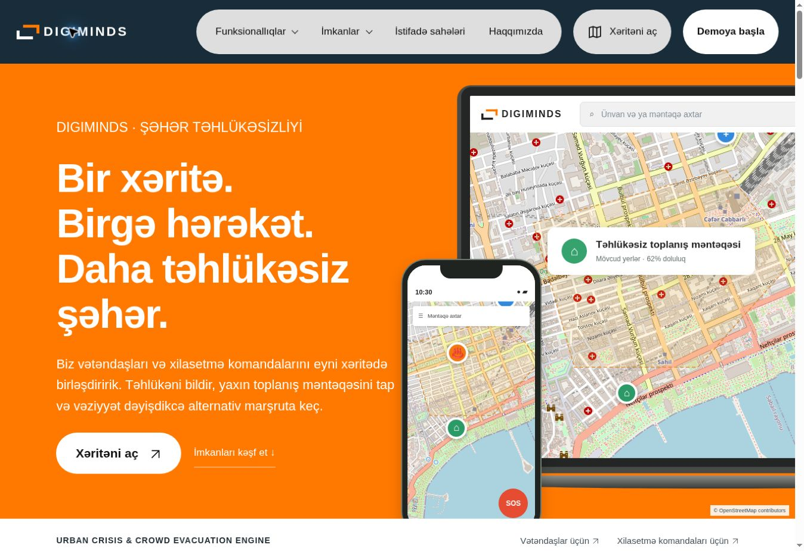

# DigiMinds · Urban Crisis & Crowd Evacuation Engine

Digital Challenge üçün işləyən FastAPI + WebSocket + offline web tətbiqi. Vətəndaş SOS-larını hadisələr üzrə birləşdirir, kritik zonaları müəyyən edir və dispetçerin müdaxiləsini qeydə alır.

**Yeni giriş səhifəsi:** Perimeter nümunəsinin səhifə quruluşunu izləyən narıncı giriş, sabit üst menyu, aşağı sürüşən xəritə/mətn bölmələri və funksiyalara birbaşa keçidlər. Əsas səhifə `/`, əməliyyat tətbiqi `/workspace.html` ünvanındadır.

**Real xəritə:** Leaflet 1.9.4 + OpenStreetMap onlayn xəritəsi. Bakı mərkəzinin 6 156 real coğrafi elementdən ibarət OSM çıxarışı tətbiqlə birlikdə saxlanır və oflayn görünüşdə işləyir. OSM raster plitələri kütləvi yüklənmir. Mənbələr: [map-data.md](docs/map-data.md).

**Təlim məlumatları:** SOS hadisələri, məntəqələr, tutumlar və hazırkı lokal marşrut qrafı simulyasiyadır. Real coğrafi fon əlavə edilməsi bu marşrutları rəsmi və ya real küçə marşrutuna çevirmir.



## Başlatmaq

**Jüri üçün telefon → səs demosu:** Windows-da **JURI_DEMO.cmd** açın. Noutbukla
telefonu eyni Wi-Fi/hotspot-a qoşun, noutbukda səsi aktivləşdirin, telefondakı
pultdan mesaj göndərin. [Addımlar və 40 saniyəlik təqdimat mətni](docs/jury-demo.md).

**Windows üçün asan yol:** GitHub-da **Code → Download ZIP**, sonra **Extract All / Hamısını çıxart**. Çıxarılan qovluqdakı **`BASLAT.cmd`** faylını iki dəfə klikləyin. Python 3.12+ varsa avtomatik tapılır; yoxdursa Windows Package Manager vasitəsilə quraşdırılmağa çalışılır. İlk açılışda paketlər qurulur və server cavab verdikdən sonra brauzer açılır. Sonrakı açılışlarda dəyişməyən paketlər yenidən endirilmir. Terminalı açıq saxlayın. 3000 portu başqa tətbiqdədirsə, boş port seçilir və düzgün ünvan açılır. Python quraşdırılması mümkün olmasa, pəncərədə göstərilən təlimatı izləyin.

`127.0.0.1` yalnız sizin kompüterinizi göstərir. Burada açılan bulud demo serverinə öz kompüterinizdə həmin ünvanla qoşula bilməzsiniz; `BASLAT.cmd` serveri məhz sizin kompüterinizdə başladır.

Python 3.12+ tələb olunur. Frontend üçün npm paketi, CDN və xarici API açarı lazım deyil.

```bash
git clone https://github.com/mustafaqasimov/DigiMinds.git
cd DigiMinds
python -m venv .venv
# Linux/macOS:
source .venv/bin/activate
# Windows PowerShell: .venv\Scripts\Activate.ps1
python -m pip install -r requirements-dev.txt
python tools/dev.py
```

Brauzerdə `http://127.0.0.1:3000` açın. `http://127.0.0.1:3000/openapi.json` API sxemidir. `npm run dev` eyni launcher-i çağırır; Node yalnız JS testlərini işlətmək üçün lazımdır.

Demo rejimində **Dispetçer → demo hesab seçin**. Hesablar: `demo-dispatcher`, `demo-observer`, `demo-responder`, `demo-admin`; hər birinin demo şifrəsi `demo`-dur. Bunlar yalnız təlim rejimi üçündür. Vətəndaş sessiyası avtomatik yaranır.

## Hazır funksiyalar

**Zəlzələ təlimi:** eyni otağa qoşulan cihazlarda sınaq mesajı ilə həyəcan ekranı
və səs, qəbul göstəriciləri və ümumi dayandırma. [Təqdimat təlimatı və Google inteqrasiyasının sərhədləri](docs/earthquake-drill.md).

| Hissə | Davranış |
| --- | --- |
| Vətəndaş | Xəritədən mövqe/GPS, uyğun məntəqələr, doluluq, piyada marşrutu, 4 SOS növü, “Təhlükəsizəm” |
| SOS +1 | Eyni növ, 180 m sabit hadisə mərkəzi, son 30 dəqiqədə yenilənən açıq hadisə; hər vətəndaş hadisədə bir dəfə sayılır |
| Qırmızı həyəcan | Son sürüşən 300 saniyədə eyni zonada **və ya** 500 m dairədə ≥4 fərqli qəbul edilmiş SOS; məntəqə doluluğu **>95%** |
| Yenidən marşrut | Bağlı yol qrafdan çıxarılır; doluluq **≥90%** olduqda məntəqə namizədlərdən çıxarılır; canlı vəziyyət dəyişəndə yenidən hesablanır |
| Dispetçer | Hadisə xəritəsi, saylar, briqadalar, 1 kliklə göndəriş və ehtiyat məntəqənin açılması; təkrar klik ikinci resurs ayırmır |
| Canlı məlumat | Autentifikasiyalı, rola görə süzülən WebSocket; əlaqə kəsilərsə 4 saniyəlik HTTP polling |
| Offline | Service Worker tətbiq/xəritə keşləyir; brauzer müstəqil Dijkstra hesablayır; SOS IndexedDB-də göndərilməmiş kimi saxlanır |
| Rollar | Vətəndaş, dispetçer, xilasedici, müşahidəçi, admin; admin icazələrdən yeni rol yarada və təyin edə bilir |
| Dillər | Azərbaycan, ingilis, rus dilləri |
| Challenge | 4 SOS dalğası, routing provider kəsilməsi, WebSocket kəsilməsi; laboratoriya yalnız demo rejimində |
| YOLO | Ayrı lokal sensor prosesi; person detection, ROI, kalibrasiya veriləndə nəfər/m², API-yə ölçmə göndərişi |

“4 fərqli SOS” burada 4 unikal hesabatdır; hadisənin `+1` sayğacı ilə ayrı saxlanır. Eyni vətəndaş müxtəlif hadisələr barədə ayrıca hesabat verə bilər. “Təhlükəsizəm” aktiv yardım sayını azaldır, daxil olmuş SOS tarixçəsini silmir. Radius qaydası yaxınlıqdakı SOS koordinatlarını dairə mərkəzləri kimi yoxlayır; tranzitiv DBSCAN zənciri istifadə edilmir.

## Xarici API nasazlığına davamlılıq

**Yeni subtask — xarici xəritə/marşrut API nasazlığı:** 503 və uzun cavabda avtomatik lokal Dijkstra, 4,5 saniyəlik provayder limiti, closed/open/half-open circuit breaker, 4 paralel çağırış limiti və üç dildə daimi ehtiyat rejimi bildirişi. Xəritə tile-ları yüklənməyəndə lokal Bakı xəritəsi açılır. Dispetçerin **Challenge laboratoriyası** bölməsində **HTTP 503 yarat**, **6 saniyə gecikdir**, **Servisi bərpa et** düymələri ilə yoxlayın. [Araşdırma, memarlıq və jüri nümayişi](docs/routing-resilience.md).

## Kütləvi tədbirlər və toplaşma məntəqələrinin potensial doluluğu

Konsert, futbol matçı, festival və mitinq kimi tədbirlər yer, gözlənilən iştirakçı sayı və vaxt ilə qeyd olunur. Hər tədbir üçün hazırda yerində olan insan sayı vaxta görə dəyişir: başlamazdan 90 dəqiqə əvvəl gəliş başlayır, tədbir boyu tam say saxlanır, bitəndən sonra 45 dəqiqə ərzində dağılış gedir.

Model təxliyə olarsa iştirakçıların 6%-nin toplaşma məntəqəsinə gedəcəyini fərz edir. Bu insanlar 2 km daxilindəki açıq məntəqələrə piyada yol məsafəsinin kvadratına tərs mütənasib paylanır (qravitasiya modeli). Hesablama marşrutla eyni yol qrafında aparılır, ona görə bağlı yollar proqnozu dəyişir. Hər məntəqə üçün **hazırkı → potensial doluluq faizi** göstərilir: normal (<70%), nəzarət (70-90%), yönləndirmə dayanır (≥90%), tutumu aşır (>100%). 90% həddini saxlamaq üçün nə qədər əlavə yer lazım olduğu da hesablanır və ən yaxın ehtiyat məntəqə tövsiyə olunur.

- **Aydın mesajlar:** hər tədbirin təsviri, yəni nə ilə bağlı olduğu göstərilir. Detal panelində **"Potensial risk proqnozu: hadisə baş verməyib"** bildirişi, tədbirin növünə görə baş verə biləcək hadisələr (izdiham, çıxışlarda tıxac, tibbi hallar, yanğın, itkin uşaqlar və s.) və risk səviyyəsi var. **Ehtiyat zona harada ayrılmalıdır** bölməsində ehtiyat məntəqə istiqamət, piyada məsafə, tutum və qəbul edəcəyi insan sayı ilə yazılır. Bir zona kifayət etmirsə, növbəti zona və qalan çatışmazlıq göstərilir, seçilmiş zonalar xəritədə işarələnir.
- **Qaynar xətt:** tədbir detalında və vətəndaşın yaxınlıqdakı tədbir kartında `tel:112` düyməsi var, əlavə olaraq 101, 102, 103 nömrələri göstərilir. Telefonda düymə zəng ekranını açır, zəngi istifadəçi özü təsdiqləyir.
- **Dispetçer:** "Tədbirlər" bölməsində siyahı və proqnoz cədvəli var. **Ehtiyat məntəqəni hazırla** düyməsi tövsiyə olunan məntəqəni açır, burada yeni tədbir də əlavə etmək olar. Xəritədə tədbirin təsir dairəsi və məntəqələrə axın xətləri görünür.
- **Vətəndaş:** 1.5 km daxilində davam edən və ya 6 saat ərzində başlayacaq tədbir barədə xəbərdarlıq kartı çıxır. Məntəqə detalında tədbirlər nəzərə alınmaqla potensial doluluq göstərilir.
- **Demo:** bazada üç sintetik tədbir yaradılır: davam edən futbol matçı, 2 saat sonra başlayacaq konsert və sabahkı festival. Laboratoriyadakı **Demo tədbirlərini yenilə** düyməsi onları cari vaxta görə yenidən qurur.

Bu proqnoz sintetik planlaşdırma modelidir. 6% payı və paylanma qaydası real müşahidə ilə kalibrasiya edilməyib.

## Vətəndaş təhlükəsizlik profili

Vətəndaş panelində **Təhlükəsizlik profilim** düyməsi və ya `/#profile` açın. Yaş, hərəkət/əlçatanlıq ehtiyacları, nəqliyyat, ailə və təcili əlaqəni ayrı kartlarda daxil edib saxlayın. Şəxsi hazırlıq siyahısı bu seçimlərə uyğun dəyişir. Paylaşma standart olaraq bağlıdır; razılıq veriləndə yalnız aktiv SOS-a baxan səlahiyyətli operator və təyin edilmiş briqada yardım profilini aça bilir.

Profil cari 8 saatlıq guest sessiyasına bağlıdır; sessiya itdikdə hesab bərpası yoxdur. Hələlik sınaq məlumatından istifadə edin. mygov inteqrasiyası və təsdiqlənmiş əlçatan marşrut əlavə edilməyib.

Dizayn mənbələri, API, testlər və məhdudiyyətlər: [citizen-profile.md](docs/citizen-profile.md).

## İki alternativ işləmə mexanizmi

1. **Xarici API-siz:** serverdə saxlanan yol qrafı və Dijkstra. Yol bağlanmaları və məntəqə yenilənmələri işləyir. Standart seçim budur.
2. **Server də əlçatmazdır:** əvvəl yüklənmiş tətbiq və xəritə, brauzerdə ayrıca Dijkstra, IndexedDB SOS növbəsi. Yeni bağlanmalar bilinmir; ekran köhnə məlumatı açıq bildirir. Yenidən qoşulanda yalnız eyni vətəndaş sessiyasına aid növbə göndərilir, idempotency açarı təkrarı önləyir.

Offline ilk açılışdan sonra və HTTPS/localhost üzərində işləyir. Brauzer məlumatları silinərsə keş və növbə də silinir. 8 saatlıq vətəndaş sessiyası bitərsə əvvəlki növbə başqa şəxs adından avtomatik göndərilmir. SMS/mesh rabitəsi bu versiyaya daxil deyil.

## YOLO

```bash
python -m pip install -r requirements-vision.txt
python -m vision.worker --source path/to/video.mp4 --save-preview data/yolo-preview.jpg
```

**Standart model: YOLO26n**, giriş ölçüsü 960, etibar həddi 0.25, maksimum 1000 aşkarlama. `ultralytics==8.4.213` saxlanılır; bu versiyada YOLO26 dəstəyi var. Kamera üçün model/ölçü seçimi və real test nəticələri: [YOLO26 sınağı](docs/yolo26-validation.md). `--model yolo26s.pt` və `--model yolo26m.pt` də istifadə edilə bilər; bu nümunədə daha böyük variantlar üstün nəticə vermədi.

GPU-suz quraşdırma üçün əvvəl PyTorch-un CPU paketlərini quraşdırmaq olar; `uv` varsa `uv pip install -r requirements-vision.txt --torch-backend cpu`. Model çəkisini ilk dəfə internetdən alır; sonra yerli `--model` yolu ilə offline işləyir. Mənbə lokal şəkil/video, kamera indeksi `0` və ya səlahiyyətli RTSP URL ola bilər. Ayrı sensor prosesi API-ni bloklamır.

Standart `partial` rejim yalnız ölçməni stdout-a verir. Kameranın bütün dolu sahəni əhatə etdiyi təsdiqlənəndən sonra:

```bash
# Eyni SENSOR_KEY server və sensor mühitinə verilməlidir.
python -m vision.worker --source path/to/video.mp4 --coverage full \
  --publish --shelter s1 --api http://127.0.0.1:3000 --area-m2 600
```

`--save-preview` son kadrı insan qutuları və sayla göstərən şəkil yaradır. `--imgsz 640` daha sürətli rejim, `--imgsz 1280` isə kiçik hədəflər üçün sınana bilən rejimdir. Aşkarlama limitinə çatanda xəbərdarlıq qaytarılır və doluluq göndərişi bloklanır.

`--area-m2` real görünən sahədir, piksel sahəsi deyil. `--roi roi.json` üçün format `[[x,y],[x,y],[x,y],...]`; şəxs qutusunun alt mərkəzi poliqonda sayılır. Kadrlar üzrə saylar bir-birinin üstünə yığılmır. Natamam görünüş ümumi tutum faizinə çevrilmir. Sıx izdiham/örtülmə üzrə ayrıca kalibrasiya lazımdır; bu versiya giriş-çıxış turniket sayğacı və çoxkameralı şəxs deduplikasiyası etmir.

## Testlər

```bash
python -m pytest -q
node --test tests/*.test.mjs
python tools/load_test.py --isolated
```

İzolyasiya edilmiş yük testi öz müvəqqəti HTTP serverini/DB-sini açıb bağlayır; nümayiş məlumatlarını dəyişmir. 1000 HTTP sorğusu, 24 şəxs, 40 paralel sorğu: 24 yeni SOS və 976 idempotent təkrar gözlənilir. Ayrı integration test 200 unikal şəxs + 200 təkrar göndərir. Canlı serverə test üçün `--isolated` əvəzinə `--base-url URL` istifadə edin; bu seçim həmin demo bazasına test məlumatı yazır. Nəticələr: [verification.md](docs/verification.md).

## Konfiqurasiya və təhlükəsizlik

`.env.example` dəyişənlərin nümunəsidir; tətbiq `.env` faylını avtomatik oxumur. Shell/servis mühitinə verin. Lokal demo üçün dəyişən tələb olunmur. Uvicorn istifadə edilirsə dotenv dəstəyi ilə `python -m uvicorn backend.app:app --env-file .env --host 127.0.0.1 --port 3000` işlədilə bilər.

| Dəyişən | Məna |
| --- | --- |
| `DEMO_MODE=0` | Demo hesabları və nasazlıq simulyasiyasını söndürür |
| `ADMIN_PASSWORD` | Demo söndürüləndə ilkin `admin` üçün ən az 16 simvol |
| `SECURE_COOKIES=1` | HTTPS yerləşdirmədə session cookie yalnız TLS ilə göndərilir |
| `DATABASE_PATH` | SQLite faylı; standart `data/crisis.db` |
| `SENSOR_KEY` | Kamera ölçmələri üçün ayrıca server açarı |
| `ORS_API_KEY` | Opsional OpenRouteService açarı; lokal rejim tələb etmir |
| `ORS_URL` | OpenRouteService foot-walking/geojson endpointi |
| `ALLOWED_ORIGINS` | Vergüllə ayrılmış əlavə etibarlı origin-lər |

PBKDF2 şifrə heşi, 8 saatlıq server sessiyası, HttpOnly/SameSite cookie, CSRF header/origin yoxlaması, Pydantic doğrulama, 64 KiB body həddi, parametrli SQL və audit jurnalı var. SOS limiti 8/dəq/şəxs, ümumi API 300/dəq/şəxs, giriş 12/dəq/IP və 8/dəq/hesab, guest 40/dəq/IP, sensor 120/dəq/məntəqə. `429` ilə `Retry-After` verilir. Rollar yalnız frontenddə gizlədilmir, hər server əməliyyatında yoxlanır.

Bu prototip tək prosesli SQLite və yaddaşdakı limiter istifadə edir. Horizontal miqyas üçün PostgreSQL/PostGIS, ortaq Redis limiter/pubsub, davamlı event queue və etibarlı şəxsiyyət doğrulaması ayrıca mərhələdir. Guest sessiyası insanın unikal şəxsiyyətini sübut etmir. Real FHN dispetçer sistemi ilə inteqrasiya yoxdur; göndəriş burada prototipin briqada statusunu dəyişir.

Arxitektura və challenge uyğunlaşdırması: [architecture.md](docs/architecture.md). Baxılan repolar və istifadə sərhədləri: [sources.md](docs/sources.md).
