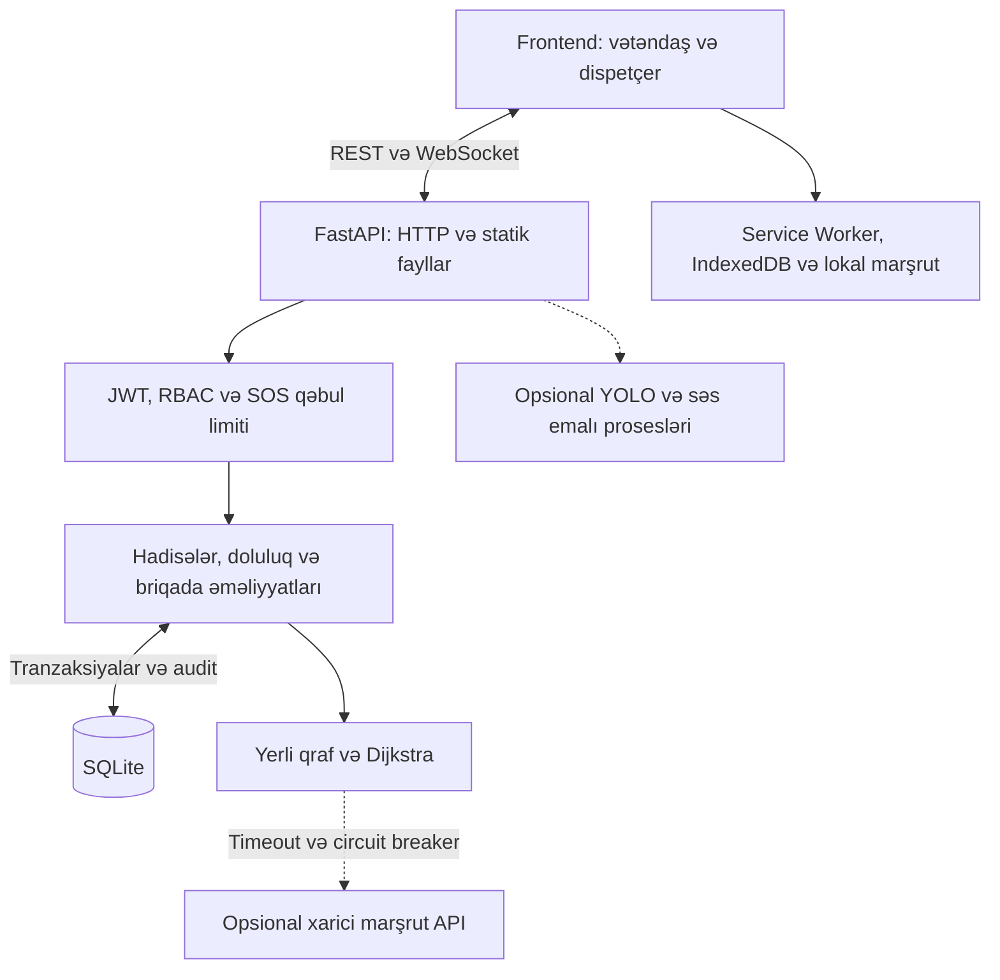

# DigiMinds · Urban Crisis & Crowd Evacuation Engine

**DIGITAL CHALLANGE** üçün vətəndaş təhlükəsizliyi və dispetçer idarəetməsini birləşdirən işlək prototip. Vətəndaş uyğun toplanış məntəqəsi və marşrut alır, SOS göndərir; dispetçer hadisələri, doluluğu və briqadaları idarə edir. Sistem xarici marşrut servisi kəsiləndə lokal hesablamaya keçir.

**Komanda:** Həsən Nurməmmədov · Asiman Mirzəliyev · Mustafa Qasımov

> **Məlumatın sərhədi:** fon xəritəsi real Bakı OpenStreetMap çıxarışıdır. Təxliyə qrafı, məntəqələr, tutumlar, əlçatanlıq atributları və hadisə nümunələri simulyasiyadır. Bunlar rəsmi təxliyə təlimatı deyil. [Xəritə mənbələri](docs/map-data.md).

## 1. Sürətli başlanğıc

İki alternativ var: **Docker Compose** və ya **lokal Python runtime**. Əsas vətəndaş/dispetçer tətbiqi üçün xarici API açarı və frontend build tələb olunmur. İlk quraşdırmada paket/image endirmək üçün internet lazımdır.

| İstifadə | Tələb |
| --- | --- |
| Docker ilə əsas tətbiq və 3 Challenge Drop | İşləyən Docker Engine və Docker Compose v2 (`--wait` dəstəyi ilə); Windows/macOS-da Docker Desktop, Linux containers rejimi |
| Lokal runtime | Python 3.12+, pip və venv; Git və ya endirilmiş ZIP |
| JavaScript və 600 paralel sorğu testi | Əlavə olaraq Node.js; layihənin CI versiyası Node 24-dür |
| Səsli SOS / YOLO | Lokal runtime və ayrıca model/paket quraşdırması; aşağıdakı bölməyə baxın |

```bash
git clone https://github.com/mustafaqasimov/DigiMinds.git
cd DigiMinds
```

Mövcud checkout-u yeniləmək üçün öz dəyişikliklərinizi saxladıqdan sonra `git pull --ff-only origin main` işlədin. JWT yenilənməsindən əvvəlki giriş sessiyası varsa hesabdan çıxıb yenidən daxil olun.

### A. Docker Compose

Repo kökündə:

```bash
docker compose up --build --wait --wait-timeout 120
docker compose ps
```

Brauzer: **http://127.0.0.1:3000** · Əməliyyat ekranı: **http://127.0.0.1:3000/workspace.html**

```bash
# Jurnalı izləmək
docker compose logs -f app

# Dayandırmaq; verilənlər saxlanır
docker compose down

# Sonrakı açılış
docker compose up --wait --wait-timeout 120

# Kod dəyişəndə image-i yenidən qurmaq
docker compose up --build --wait --wait-timeout 120
```

- `Dockerfile` Python 3.12 əsasında əsas asılılıqları quraşdırır, tətbiqi **root olmayan UID 10001** və **bir Uvicorn worker** ilə işə salır.
- `compose.yaml` frontend və API-ni eyni origin-dən təqdim edən `app` konteynerini başladır. SQLite üçün ayrıca DB serveri lazım deyil.
- `/app/data` **`app_data` adlı volume** ilə saxlanır: SQLite, WAL faylları və demo JWT imza açarı konteyner yenidən yaradılanda itmir. Compose volume adının əvvəlinə layihə adını əlavə edə bilər.
- Healthcheck `/api/health` cavabında `ok: true` yoxlayır. `--wait` sağlam vəziyyət yaranana qədər gözləyir; image build vaxtı bu gözləmə limitindən ayrıdır.
- `.dockerignore` lokal DB, `.env`, JWT/TLS açarları, virtual mühit və model çəkilərini build kontekstindən çıxarır. Mənbə faylları konteynerdə yalnız oxunandır; iş məlumatı volume-a yazılır.
- **Əsas image səs/YOLO paketlərini və modellərini daşımır.** Bu əlavə funksiyalar üçün lokal quraşdırma bölməsindən istifadə edin. Üç Challenge Drop əsas image-dədir.

**Port məşğuldursa:** repo kökündə `.env` faylına `PORT=3001` yazın və eyni Compose əmri ilə başladın; ünvan `http://127.0.0.1:3001` olacaq. Standart `HOST_BIND=127.0.0.1` yalnız bu kompüterdən giriş verir. Eyni Wi-Fi cihazlarına açmaq üçün `.env` daxilində `HOST_BIND=0.0.0.0` təyin edin və firewall-da seçilmiş porta icazə verin. Bu, HTTPS yaratmır; telefon mikrofonu/sensoru üçün aşağıdakı HTTPS təlimatına baxın.

`docker compose down --volumes` **DB və demo JWT açarı daxil olmaqla volume-u silir**. Bu əmrdən yalnız demo məlumatını sıfırlamaq istədikdə istifadə edin. Lokal Python-un `data/` qovluğu ilə Docker volume-u ayrı məlumat bazalarıdır.

### B. Lokal runtime

**Windows üçün ən qısa yol:** ZIP-i tam çıxarın və `BASLAT.cmd` faylını açın. Launcher Python-u tapır, `.venv` yaradır, paketləri quraşdırır və server hazır olduqda brauzeri açır. Terminalı açıq saxlayın. Port 3000 məşğuldursa boş port seçilir; terminaldakı faktiki ünvanı istifadə edin.

Əllə quraşdırma, **Windows PowerShell**:

```powershell
py -3.12 -m venv .venv
.\.venv\Scripts\python.exe -m pip install -r requirements-dev.txt
.\.venv\Scripts\python.exe tools/dev.py
```

**Linux/macOS**:

```bash
python3.12 -m venv .venv
source .venv/bin/activate
python -m pip install -r requirements-dev.txt
python tools/dev.py
```

Əsas tətbiq üçün `requirements.txt` kifayətdir; yuxarıda testləri də işlətmək üçün `requirements-dev.txt` verilib. Lokal ünvan `http://127.0.0.1:3000`, dayandırmaq `Ctrl+C`-dir. DB avtomatik yaradılır və sxem əlavələri tətbiq olunur; ayrıca migration əmri yoxdur. Dəyişiklikdən əvvəl mövcud DB-nin ehtiyat nüsxəsini alın.

**`.env` ilə lokal açılış:** `.env.example` faylını `.env` adına kopyalayın və lazımi dəyişənləri yazın. `tools/dev.py` və `tools/start.py` `.env` faylını avtomatik oxumur. Açıq şəkildə oxutmaq üçün aktiv virtual mühitdə:

```bash
python -m uvicorn backend.app:app --env-file .env --host 127.0.0.1 --port 3000 --workers 1 --no-proxy-headers --no-access-log
```

Compose isə aşağıdakı konfiqurasiya dəyişənlərini `.env`/shell-dən `environment` bölməsi vasitəsilə konteynerə ötürür. Docker-də `DATABASE_PATH` volume daxilində `/app/data/crisis.db` olaraq sabit saxlanır.

### Açılışı yoxlamaq və demo hesablar

| Ünvan | Gözlənilən nəticə |
| --- | --- |
| `/` | Giriş səhifəsi |
| `/workspace.html` | Vətəndaş və dispetçer tətbiqi |
| `/api/health` | `ok: true`, demo rejimi və dataset məlumatı |
| `/docs` / `/openapi.json` | İnteraktiv API sxemi / JSON sxemi |
| `/vision.html` | Əlavə YOLO video analiz ekranı |
| `/workspace.html#voice` | Əlavə Səsli SOS ekranı |
| `/sensor` | Telefonun titrəmə sensoru ekranı |

Demo rejimində şifrə **`demo`**-dur:

| Hesab | Təyinat |
| --- | --- |
| `demo-dispatcher` | Hadisə və briqada idarəetməsi |
| `demo-admin` | İdarəetmə, rol təyin etmə və audit |
| `demo-observer` | Əməliyyat məlumatlarının müşahidəsi |
| `demo-responder` | Öz briqadası və təyin edilmiş hadisə |
| `demo-priority_citizen` | Xüsusi qayğıya ehtiyacı olan vətəndaş, Priority 1 |

Adi vətəndaş sessiyası avtomatik yaranır. Vətəndaş və dispetçeri eyni anda sınaqdan keçirmək üçün ayrı brauzer profilləri və ya gizli pəncərə istifadə edin. Demo hesablarını açıq istehsal xidməti kimi yayımlamayın.

## 2. Sistem arxitekturası və məlumat axını



**SOS axını:** frontend mətn/növ/mövqe və `event_key` göndərir → qəbul limiti artıq yükü body/DB emalından əvvəl rədd edir → JWT imzası, sessiya və aktual rol yoxlanır → SQLite tranzaksiyasında dublikat/kvota/hesabat işlənir → hadisə və xəbərdarlıq hesablanır → rola uyğun WebSocket snapshot-u və ya HTTP polling ilə ekran yenilənir. Diaqram məntiqi komponentləri göstərir; qəbul limiti middleware səviyyəsində işləyir.

**Marşrut axını:** mövqe və əlçatanlıq ehtiyacı → bağlı yolların və doluluğu ≥90% olan məntəqələrin çıxarılması → lokal Dijkstra → uyğun adi vətəndaş sorğusunda opsional xarici API → nasazlıqda hazır lokal nəticə. Prioritet vətəndaş xarici `foot-walking` provayderinə göndərilmir; yalnız əlçatanlığı işarələnmiş lokal qraf istifadə edilir.

**DB axını:** `backend/seed.py` demo qrafını yaradır; `backend/store.py` hesabatları, hadisələri, rolları, sessiyaları, yol/məntəqə vəziyyətini, dublikat açarlarını və auditi saxlayır. Diskdə SQLite WAL rejimi istifadə olunur. `frontend/baku.geojson` real coğrafi fondur və təxliyə qrafından ayrıdır.

| Hissə | Əsas fayllar və genişlənmə nöqtəsi |
| --- | --- |
| API və giriş yoxlamaları | `backend/app.py`, `security.py`, `request_guards.py`, `sos_guard.py` |
| Qaydalar və məlumat | `backend/store.py`, `seed.py`, `geo.py`, `accessibility.py` |
| Xarici API-yə davamlılıq | `backend/circuit.py`, `frontend/routing-client.js`, `map-circuit.js` |
| Frontend və oflayn iş | `frontend/app.js`, `ui.js`, `offline.js`, `sw.js` |
| Dil dəstəyi | `frontend/i18n.js` və modul üzrə `*-i18n.js` faylları |
| Profil, tədbir və sensor | `backend/profiles.py`, `events.py`, `seismic.py` |
| Opsional AI | `backend/voice.py`, `speech/`, `backend/vision_jobs.py`, `vision/` |

Prototip bir tətbiq prosesi ilə işləyir. Rollar permission siyahıları, dillər tərcümə lüğətləri, xarici servis isə ayrıca circuit/provider qatı ilə genişlənir. Çox worker/replika üçün SQLite, prosesdaxili limiter və circuit vəziyyəti ortaq DB/Redis və koordinasiyalı qəbul nəzarəti ilə dəyişdirilməlidir. Sadəcə `--workers` sayını artırmaq eyni qorumanı saxlamır. [Ətraflı arxitektura](docs/architecture.md).

## 3. Challenge Drop və dinamik texniki şərtlər

Yarış şərtinə görə **12:00, 13:00 və 14:00-da** münsiflər üç gözlənilməz texniki dəyişiklik elan edir. Yeni rol/dil, xarici API kəsintisi və yüksək yük/təhlükəsizlik tələbi kimi dəyişikliklərə uyğunlaşmaq tələb olunur. Aşağıda komandaya verilmiş üç konkret subtask və repodakı qarşılığı göstərilir; saatlar yarış cədvəlidir, avtomatik planlaşdırılmış sistem işi deyil.

| Subtask | Tələb | Mövcud nəticə |
| --- | --- | --- |
| 1. Prioritet vətəndaş | Avtomatik Kritik / Priority 1 SOS; yalnız panduslu, maneəsiz, əlil arabası/tibbi nəqliyyat üçün əlçatan marşrut | Rol, serverdə prioritet və server/brauzerdə eyni əlçatanlıq filtri var; real yol reyestri əvəzinə demo atributları istifadə olunur |
| 2. Xarici API kəsintisi | HTTP 503 və ya >5 saniyə gecikmədə çökmədən lokal ehtiyat hesablaması və görünən bildiriş | 4,5 s provayder limiti, circuit breaker, lokal Dijkstra, xəritə və brauzer fallback-ı var |
| 3. 500+ saxta SOS | Rate limiting, dublikat filtrasiyası, JWT/RBAC, orta latency <300 ms | Təhlükəsizlik və qəbul qoruması var; 600 paralel sorğu ölçülüb. **Bütün ssenarilərdə <300 ms hədəfi tam ödənməyib** |

### Subtask 1 — Xüsusi qayğı və Priority 1

- Rol: `priority_citizen`; adi vətəndaşın icazələri qalır, dispetçer səlahiyyəti verilmir.
- Priority 1 serverdə təyin olunur; istifadəçinin payload-a özbaşına `priority` əlavə etməsi qəbul edilmir. Kritik xəbərdarlıq üçün 4 SOS yığılması gözlənilmir.
- Yol və məntəqə üçün `accessibility_verified`, `step_free`, `ramp_access`, `obstacle_free`, `wheelchair_accessible`, `medical_vehicle_accessible` atributlarının **hamısı true** olmalıdır. Naməlum məlumat əlçatan sayılmır.
- Bağlı yol və ≥90% dolu məntəqə çıxarılır. Başlanğıc nöqtəsi qraf düyünündən 2 m-dən uzaqdırsa yoxlanmamış keçid uydurulmur; bu hədd demo üçündür, GPS dəqiqliyi zəmanəti deyil.
- Uyğun yol yoxdursa **“Təsdiqlənmiş əlçatan marşrut yoxdur”** göstərilir. Adi piyada yoluna səssiz keçid edilmir; eyni qayda oflayn brauzerdə də tətbiq olunur.

**Nümayiş:** `/workspace.html` → hesab/iş rejimi → **Prioritet SOS rolunu aktivləşdir**, yaxud `demo-priority_citizen` ilə daxil olun. Standart demo mövqeyindən SOS göndərin. Ayrı dispetçer sessiyasında **Kritik · Priority 1** və əlçatan marşrut davranışını yoxlayın.

**Sübut:** `tests/test_priority_accessibility.py`, `tests/priority-accessibility.test.mjs`. [Tam davranış və sərhədlər](docs/priority-accessibility.md).

### Subtask 2 — HTTP 503 və 5 saniyədən uzun gecikmə

- Xarici çağırışın bütün müddəti `asyncio.timeout(4.5)` ilə məhdudlaşdırılır; təkcə read timeout-a arxalanılmır.
- Circuit: **closed → 3 ardıcıl xəta → open (30 s) → half-open (1 sınaq sorğusu)**. Uğurlu sınaq circuit-i bağlayır, uğursuz sınaq yenidən açır.
- Proses üzrə maksimum **4 paralel xarici çağırış** var; artıq sorğular növbədə gözləmədən lokal cavab alır.
- Ehtiyat mənbə lokal koordinat/yol qrafıdır. Cavab gözlənilərkən yol bağlanarsa və ya məntəqə dolarsa köhnə marşrut istifadə edilmir, lokal nəticə yenidən hesablanır.
- Vətəndaşa **“Oflayn/ehtiyat marşrut rejimində işləyir”** bildirişi göstərilir. Cavabda `routing.mode`, `reason`, circuit vəziyyəti və ölçülmüş vaxt var.
- Xəritə tile xətası lokal Bakı coğrafi fonuna keçir. Serverə də çıxış kəsilərsə əvvəldən keşlənmiş tətbiq/qraf istifadə olunur; yeni yol və doluluq vəziyyəti həmin anda bilinmir.

**Nümayiş:** dispetçer → **Challenge laboratoriyası** → **HTTP 503 yarat** → marşrutu yoxlayın. Üç xəta sonrası `circuit_open` müşahidə edin. **Servisi bərpa et** və bərpa fasiləsindən sonra yenidən yoxlayın. Ayrı sınaqda **6 saniyə gecikdir** seçin: provayder təxminən 4,5 s-də dayandırılır və lokal cavab verilir. Əsaslandırma və nəqliyyat səviyyəsində sınaqlar: [routing-resilience.md](docs/routing-resilience.md).

API açarı verilməməsi xəta sayılmır: tətbiq standart lokal rejimdə işləyir. Heç vaxt açılmamış saytın internetsiz ilk açılışı və keşdə olmayan məlumatın yaradılması fallback imkanına daxil deyil.

### Subtask 3 — SOS Flood, JWT və RBAC

**Qəbul və dublikat nəzarəti:** `/api/sos` və SOS yaradan seismic check-in endpointləri eyni qəbul qorumasından istifadə edir.

| Nəzarət | Standart hədd / davranış |
| --- | --- |
| IP trafiki | 1200 SOS sorğusu / 60 s, autentifikasiyasız trafik də daxil |
| Hesab trafiki | 60 sorğu / 60 s, təkrar göndərişlər də daxil |
| Yeni göndəriş açarı | 8 / hesab / 60 s, eyni hesabın sessiyaları arasında ortaq |
| Qəbul edilmiş paralel sorğu | Server üzrə 16, hesab üzrə 2 |
| SOS emal yerləri | 4; dispetçerin standart işçi hovuzundan ayrı |
| Body və vaxt həddi | Adi sorğuda 64 KiB və body qəbuluna 5 s |
| Yük aşılması | HTTP 429, `Retry-After`, qəbul qatında `X-RateLimit-Scope` |
| Dublikat | `(user_id, event_key)` və eyni şəxsin eyni hadisəyə təkrarı; restartdan sonra da `sos_deliveries` ilə saxlanır |

Eyni açarla ziddiyyətli məlumat `409` verir; normal təkrar `200` qaytarır və insan sayını artırmır. Dublikatlar trafik kvotasından azad deyil. Brauzerin əl ilə göndərişi və oflayn növbəsi `Retry-After` müddətinə əməl edir. Bu mexanizm **yalan xəbəri müəyyən edən model deyil**; qəbul yükünü və təkrarları məhdudlaşdırır.

**Autentifikasiya:** HS256 JWT-də imza, `iss`, `aud`, `iat`, `nbf`, `exp`, `sub`, `role`, `jti` yoxlanır. Tokenin heşi aktiv server sessiyasında da olmalıdır; logout onu ləğv edir. İcazələr JWT-dəki köhnə roldan deyil, bazadakı **cari roldan** alınır. `alg=none`, dəyişdirilmiş/vaxtı bitmiş token və icazəsiz rol rədd edilir.

**Kritik əməliyyatlar:** `/api/alerts/{id}/dispatch`, `/open_shelter`, `/respond` üçün `incident:act` lazımdır. Adi/prioritet vətəndaş, müşahidəçi və xilasedici briqada ayıra bilmir. Əməliyyat atomik, təkrar çağırışda idempotent və auditlidir. Birgə `/respond` uyğun briqada və ehtiyat məntəqəni eyni tranzaksiyada ayırır.

**600 paralel sorğu üçün son saxlanmış ölçmə** (`3007856` dəyişiklik dəsti; client end-to-end, keep-alive):

| Ssenari | SOS orta | Qəbul edilmiş SOS orta | Panel oxuması orta | Briqada təyinatı orta |
| --- | ---: | ---: | ---: | ---: |
| Eyni açarın təkrarı | 98,82 ms | 209,42 ms | 188,74 ms | 175,53 ms |
| 24 hesabdan yeni açarlar | 215,27 ms | **429,82 ms** | **364,22 ms** | **360,45 ms** |
| Etibarsız JWT | 74,41 ms | Qəbul yoxdur | 141,27 ms | 146,20 ms |

Bütün 600 TCP bağlantısı yenidən qurulanda da bəzi orta nəticələr 300 ms-dən yuxarıdır. Funksional sınaqlarda 5xx olmayıb və dispetçer sorğuları uğurlu olub, lakin **məhdudiyyətsiz <300 ms tələbi tam sübut edilməyib**. Test uğurlu SOS-ları ayrıca ölçür: sürətli 429-lar ləng qəbul edilmiş sorğuları gizlətmir. `Server-Timing` client ölçməsini əvəz etmir. [Tam hesabat](docs/sos-flood.md) · [Xam ölçmələr](docs/sos-flood-results.json).

## 4. Testləri təkrar işlətmək

Repo kökündə, lokal virtual mühit aktiv olduqda:

```bash
python -m pip install -r requirements-dev.txt
python -m pytest -q
node --test tests/*.test.mjs

# Normal yük: 1000 göndəriş, 24 şəxs, 8 paralel sorğu
python tools/load_test.py --isolated --requests 1000

# 600 eyni vaxtlı SOS + panel oxumaları + briqada əməliyyatları
python tools/flood_test.py --requests 600 --output flood-results.json
python tools/flood_test.py --requests 600 --cold --output flood-cold-results.json
```

Normal yük və flood alətləri öz müvəqqəti DB/serverlərini yaradır. Flood nəticələri lokal JSON-a yazılır. Funksional xəta **və ya hər hansı ölçülən qrupun orta gecikməsi ≥300 ms** olduqda flood əmri qeyri-sıfır kodla bitir. Bu davranış qəsdən saxlanılıb; testin uğursuzluğu gizlədilmir. Normal yük alətinə `--base-url` versəniz artıq göstərilən serverin məlumatlarını dəyişərsiniz.

Hədəfli subtask testləri:

```bash
python -m pytest -q tests/test_priority_accessibility.py tests/test_routing_fallback.py tests/test_sos_security.py
node --test tests/priority-accessibility.test.mjs tests/routing-fallback.test.mjs
```

`3007856` commitində qeydə alınan nəticə **182 Python keçib, 2 buraxılıb; 47 JavaScript keçib**. Opsional video/audio asılılığı olmayan mühitdə əlaqəli testlər buraxıla bilər. Tam brauzer sınağı Playwright/Chromium tələb edir: `node tools/verify_capacity.mjs`. [Doluluq üzrə tələblər auditi](docs/requirements-audit.md).

**Docker restart/persistence sınağı:** aşağıdakı alət bir süni SOS yaradır; ayrıca demo deployment-də işlədin. Python-un standart kitabxanası kifayətdir. Müvəqqəti faylda demo giriş tokeni saxlandığı üçün onu paylaşmayın; uğurlu `verify` onu silir.

```bash
python tools/container_smoke.py seed --state /tmp/digiminds-smoke.json
docker compose down
docker compose up --wait --wait-timeout 120
python tools/container_smoke.py verify --state /tmp/digiminds-smoke.json
```

Windows-da `/tmp/digiminds-smoke.json` əvəzinə müvəqqəti qovluqdakı fayl yolunu verin. Port dəyişibsə hər iki Python əmrinə `--base-url http://127.0.0.1:3001` əlavə edin.

GitHub Actions-da ayrıca `docker-smoke` işi image build, healthcheck, root olmayan istifadəçi, statik fayllar, JWT giriş, SOS dublikatı və konteyner yenidən yaradıldıqda DB/JWT açarının saxlanmasını yoxlayır. Digər işlər Python/JS, normal/flood yükü, Windows launcher və brauzer axınını yoxlayır. Workflow olması onun bütün ölçmələrdə keçdiyi demək deyil; [cari CI nəticəsini açın](https://github.com/mustafaqasimov/DigiMinds/actions).

## 5. Konfiqurasiya

| Dəyişən | İstifadə |
| --- | --- |
| `DEMO_MODE` | `1`: demo hesabları/laboratoriya; `0`: demo bağlıdır |
| `DATABASE_PATH` | Lokal standart `data/crisis.db`; Compose-də `/app/data/crisis.db` |
| `JWT_SECRET` | Demo boşdursa DB yanında `.jwt-key` yaradılır; demo söndürüləndə ən az 32 baytlıq təsadüfi açar tələb olunur |
| `ADMIN_PASSWORD` | `DEMO_MODE=0` üçün ilkin `admin` yaradılarkən ən az 16 simvol |
| `SECURE_COOKIES` | TLS ilə yerləşdirmədə `1`; lokal HTTP nümayişində `0` |
| `SENSOR_KEY` | YOLO sensorundan məntəqəyə ölçmə göndərişi üçün ortaq açar |
| `ORS_API_KEY`, `ORS_URL` | Opsional OpenRouteService; boş açarla lokal marşrut işləyir |
| `ALLOWED_ORIGINS` | Əlavə etibarlı origin-lər; bu, ayrıca cross-origin frontend/CORS quruluşu yaratmır |
| `DIGIMINDS_PUBLIC_URL` | Demo üçün göstərilən xarici ünvan; özü TLS və proxy qurmur |
| `HOST_BIND`, `PORT` | Yalnız Compose host bind/port parametrləri |

Güclü açarı lokal yaratmaq: `python -c "import secrets; print(secrets.token_urlsafe(48))"`. Açarları `.env` və ya servis mühitində saxlayın, Git-ə əlavə etməyin. `DEMO_MODE=0` təkbaşına real FHN inteqrasiyası və ya istehsal hazırlığı yaratmır. İctimai yerləşdirmə üçün HTTPS və şəbəkə qoruması lazımdır. Forwarded-header etibarı standart olaraq bağlıdır; reverse proxy istifadə ediləndə yalnız etibarlı proxy ayrıca konfiqurasiya olunmalıdır.

## 6. Əlavə funksiyalar

Əsas Docker tətbiqini dayandırıb lokal runtime-da əlavə modulları başlada bilərsiniz; iki mühitin DB-si ayrıdır.

| Funksiya | Başlatmaq / təlimat |
| --- | --- |
| Azərbaycan dilində Səsli SOS | Windows `SES_BASLAT.cmd`; digər mühitdə `python tools/start.py --voice`. İlk dəfə təxminən 1,6 GB model endirilir. [Səsli SOS](docs/voice-sos.md) |
| YOLO video analizi | Windows `YOLO_BASLAT.cmd`; digər mühitdə `python tools/start.py --vision`. [Video yükləmə](docs/web-yolo.md), [model sınaqları](docs/yolo26-validation.md) |
| Hər iki əlavə modul | `python tools/start.py --voice --vision` |
| Telefon mikrofonu və titrəmə sensoru | `python tools/start.py --voice --https` və ya `BASLAT-SENSOR.cmd`; eyni Wi-Fi, OpenSSL və sertifikatın cihazda qəbul edilməsi tələb olunur |
| Jüri üçün telefon pultu və alarm | `JURI_DEMO.cmd`; [nümayiş addımları](docs/jury-demo.md), [alarmın sərhədləri](docs/earthquake-drill.md) |
| Vətəndaş profili | `/workspace.html#profile`; [profil və məlumat paylaşımı](docs/citizen-profile.md) |

Səsli SOS: **Səs yazmağa başla → mikrofon icazəsi → danış → Bitir və mətnə çevir → mətni/növü/mövqeyi yoxla → SOS göndər**. Model server kompüterində işləyir, hər telefon ayrıca model yükləmir. Serverə çıxış yoxdursa yeni səsin tanınması işləmir; əl ilə SOS oflayn növbədə qala bilər. Danışıq tempi panika diaqnozu deyil.

YOLO veb yükləməsi **100 MB / 60 saniyə / Full HD / 60 FPS** ilə məhduddur. Video yükləmək məntəqənin doluluğunu avtomatik dəyişmir. Tam əhatəsi təsdiqlənmiş ayrıca sensor üçün `vision.worker`, `--publish`, `--coverage full`, `--shelter` və `SENSOR_KEY` lazımdır; nəfər/m² üçün real sahə kalibrasiyası tələb olunur.

Titrəmə modulu telefon siqnallarını bir neçə cihaz üzrə müqayisə edir, vətəndaşın **Təhlükəsizəm / Yardım lazımdır / Binada qalmışam** cavablarını qəbul edir. Google zəlzələ xəbərdarlığından açıq inteqrasiya yoxdur. Kütləvi tədbir doluluq proqnozu və istilik xəritəsi də mövcuddur; tədbirdən təxliyədə 6% iştirakçı fərziyyəsi real müşahidə ilə kalibrasiya edilməmiş planlaşdırma modelidir.

## 7. Tez-tez rast gəlinən problemlər

- **Docker daemon-a qoşulmur:** Docker Desktop/Engine-i başladın, `docker info` yoxlayın. Köhnə Compose-də `--wait` tanınmırsa Compose v2-ni yeniləyin.
- **Port artıq istifadə olunur:** Compose üçün `PORT` dəyişin; launcher-in çap etdiyi portu istifadə edin. `127.0.0.1` hər cihazın özünü göstərir, telefon üçün kompüterin LAN IP-si lazımdır.
- **Mikrofon düyməsi aktiv deyil:** səs modelini ayrıca quraşdırın, `/api/voice/status` yoxlayın. Telefonun adi `http://192.168...` ünvanında mikrofon məhdudlaşdırıla bilər; HTTPS və icazə lazımdır.
- **401 və ya köhnə sessiya:** JWT yenilənməsindən sonra yenidən daxil olun. Docker volume/JWT açarı silinibsə əvvəlki tokenlər etibarsızdır.
- **429:** qəbul və ya trafik limiti aşılıb; `Retry-After` qədər gözləyin. Bu cavab SOS-un qeydə alındığını bildirmir.
- **403:** istifadəçi rolunu, `Origin` və `X-Requested-With: DigiMinds` / Bearer autentifikasiyasını yoxlayın.
- **Əlçatan marşrut yoxdur:** başlanğıcın demo qrafına uyğunluğunu, yol atributlarını və məntəqə doluluğunu yoxlayın. Sistem təhlükəsizliyi təsdiqlənməmiş yol uydurmur.
- **Flood testi qeyri-sıfır kodla bitir:** JSON-dakı funksional yoxlama və gecikmə qruplarını ayrı oxuyun. <300 ms hədəfi cari ölçmələrdə bütün ssenarilər üçün keçmir.

## 8. Texniki istinadlar

[Arxitektura](docs/architecture.md) · [Tələblər auditi](docs/requirements-audit.md) · [Prioritet rol](docs/priority-accessibility.md) · [Circuit breaker](docs/routing-resilience.md) · [SOS Flood və JWT](docs/sos-flood.md) · [Əvvəlki yoxlamalar](docs/verification.md) · [Mənbələr](docs/sources.md)

Docker davranışı: [Compose up](https://docs.docker.com/reference/cli/docker/compose/up/), [Dockerfile və healthcheck](https://docs.docker.com/reference/dockerfile/), [Compose mühit dəyişənləri](https://docs.docker.com/compose/how-tos/environment-variables/set-environment-variables/).
