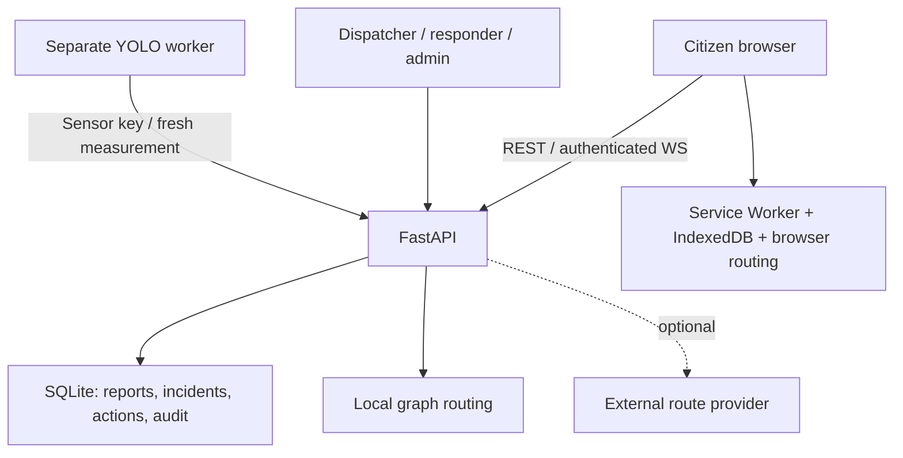

# Architecture & challenge boundaries

## Components

`backend/app.py` owns auth, input validation and transport. `store.py` owns transactional decisions and rolling-window alerts. `geo.py` is independent of HTTP. `seed.py` owns the replaceable simulation dataset. `frontend/offline.js` owns API-free routing and durable pending messages. `vision` remains an optional process: the web server does not import PyTorch.

## Data contracts

| Endpoint | Access / result |
| --- | --- |
| `POST /api/auth/guest` | Anonymous citizen session; resumes the separate citizen cookie after operator switching |
| `POST /api/auth/login`, `POST /api/auth/logout` | Signed HS256 JWT + server session / immediate revocation |
| `GET /api/state`, `GET /api/map` | Authenticated role-filtered snapshot / sanitized public map |
| `POST /api/sos` | `event_key,type,lat,lng,incident_id?,client_time?,voice_note?`; 201 new, 200 duplicate, 409 conflict, 429 + Retry-After when limited |
| `POST /api/me/safe` | Own reports become safe |
| `GET /api/routes?lat=…&lng=…&mode=local` | Reachable shelters sorted by network distance; never fabricates a direct line |
| `PATCH /api/roads/{id}` | `road:write`; `{enabled:true}` blocks edge |
| `PATCH /api/shelters/{id}/occupancy` | `shelter:write` or sensor key; freshness/coverage checks |
| `POST /api/alerts/{id}/dispatch` | JWT + current `incident:act` permission; atomic team allocation; retry returns original result |
| `POST /api/alerts/{id}/open_shelter` | Opens an existing reachable reserve site; no resource → 409 |
| `PATCH /api/teams/{id}` | Operator or assigned responder; en_route → on_scene → available |
| `GET/POST /api/roles`, `PATCH /api/users/{id}/role` | Administrator role management |
| `GET /api/audit` | Administrator audit read |
| `POST /api/demo/{sos_wave,provider,websocket}` | Demo-only challenge injection |
| `WS /ws` | Cookie/Bearer + Origin validation; changing roles are reapplied during connection |

## Decisions worth preserving

- The SOS event key belongs to one user. Reusing it with changed type/coordinates returns conflict. A second event key from the same person for the same incident does not add another person.
- Incident grouping and red-alert detection are separate operations. Four reports of one fire form **one incident with count 4**, which still triggers the alert rule.
- An incident uses a fixed 180 m anchor. Nearby chained reports cannot pull that incident across the city. Radius alerts examine 500 m circles centered at report coordinates, not transitive clusters.
- The 300-second window uses server receipt time, including events delayed by an offline queue. `client_time` is retained for context and cannot silently bypass the window.
- Zone alerts choose the incident with most recent-window reports before dispatch. An allocated assignment stays stable. Skill compatibility and shortest reachable network path determine the team, not raw straight-line proximity alone.
- Alert trigger expiry does not automatically free a team. The operator still owns the response. Current prototype retains old alerts with an inactive-condition label; a richer incident closure workflow is a later extension.
- `>=90%` excludes a shelter from route destinations; `>95%` triggers a red capacity alert. These intentionally differ at exactly 95%.
- The external provider gets buffered closure polygons; its result is checked for closure intersections. If occupancy/road state changes during the awaited request, a fresh local route replaces the result. The external call has a 4.5-second total asynchronous deadline; after 3 errors the circuit pauses new calls for 30 seconds and permits one half-open recovery probe. At most 4 provider calls are in flight per process; excess calls immediately use local Dijkstra. A separate browser 5-second deadline protects against an unavailable route API. See [routing resilience](routing-resilience.md) for the design, map fallback, evidence and demo steps.
- Public citizens do not receive individual SOS coordinates. Responders receive only their own team and assigned incident. Dispatcher/observer snapshots receive operational detail. Admin role changes are recorded.
- Offline maps only cache public graph/shelter state. Operational reports/teams are not stored in that shared cache. Pending SOS retain their owner and are not submitted by a different signed-in role.

## Challenge drops

| Drop | Adaptation point | Existing verification |
| --- | --- | --- |
| External route API down | `routes()` timeout/circuit → local Dijkstra | Provider-down + asynchronous-state-race tests |
| WebSocket down | `connect()` backoff and 4-second `refresh()` | Live browser challenge toggle |
| Server unreachable | Service Worker + browser Dijkstra + outbox | Browser reload during stopped preview |
| New role | Permission list stored as data; server + UI derive behavior | Role creation/assignment integration test |
| Mass SOS / duplicates | Pre-body IP/account admission; dedicated worker capacity; durable delivery aliases; JWT/RBAC | 600 simultaneous real HTTP requests with concurrent dispatch/dashboard checks; see [flood verification](sos-flood.md) |
| Camera stops/stale | Timestamp/ordering rejection, stale measurement marker | Partial/stale sensor integration tests |

Large-city routing and multi-instance deployment require replacing the small simulated graph, SQLite and process-local limiter. The current code intentionally avoids Kafka, Kubernetes and unnecessary service splits for a prototype; the transport/domain/vision boundaries remain replaceable.
