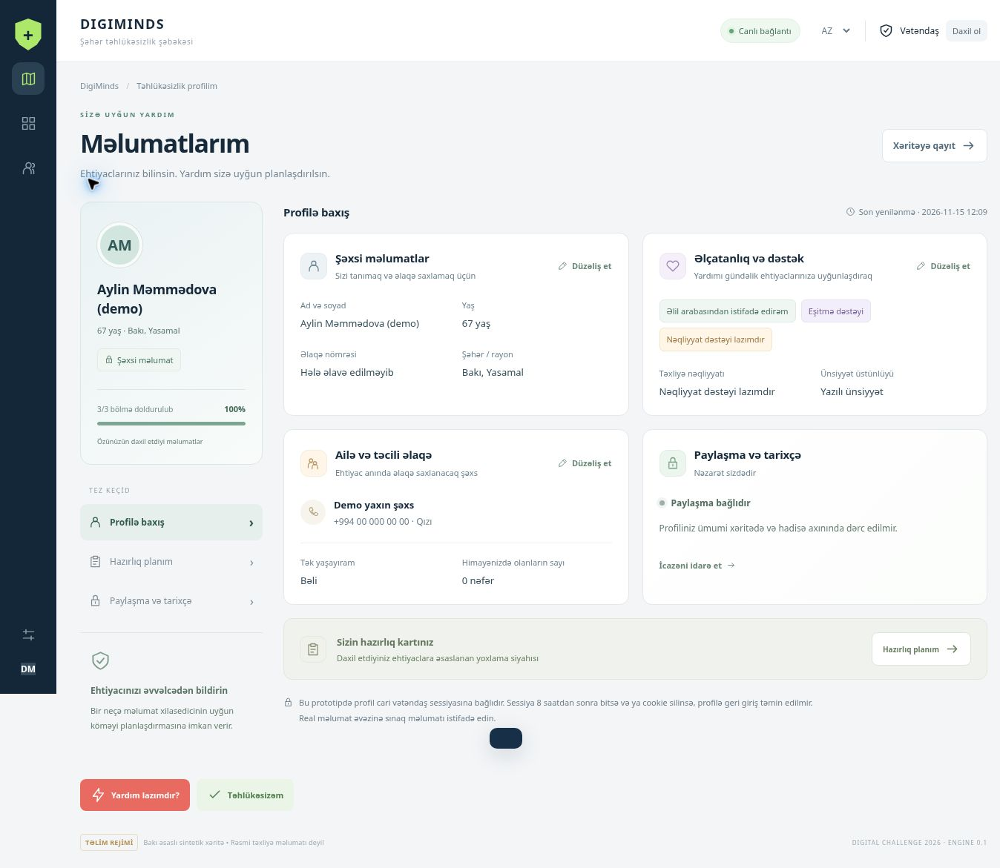

# Vətəndaş təhlükəsizlik profili

Branch: `feature/citizen-safety-profile`. Əsas: `9bdb286`.

Vətəndaş ekranındakı **Təhlükəsizlik profilim** düyməsi və ya `/#profile` profili açır. Yaş, hərəkət imkanları, görmə/eşitmə və sadə izah ehtiyacları, nəqliyyat, ailə, təcili əlaqə və xilasedici üçün qeyd ayrıca kartlarda saxlanılır. İstifadəçi məlumatı dəyişə, silə və aktiv SOS üçün paylaşma icazəsini idarə edə bilər. Bütün sahələr könüllüdür; təcili əlaqənin adı və nömrəsi birlikdə daxil edilməlidir.

## Araşdırma və tətbiq edilən qərarlar

15 noyabr 2026 tarixində aşağıdakı ilkin mənbələrə baxılıb. Repozitoriyaların README-ləri araşdırılıb; onların tam tətbiqləri quraşdırılıb təsdiqlənməyib. Xarici kod, loqo və ekran şəkli kopyalanmayıb.

| Mənbə | Mənbədə təsvir edilən yanaşma | DigiMinds-də uyğunlaşdırma |
| --- | --- | --- |
| [mygov — Məlumatlarım](https://my.gov.az/landing-my-info) və [İRİA kateqoriyalar açıqlaması](https://idda.az/az/xeberler/mygov-tetbiqinde-yeni-funksionalliq-melumatlar-ve-xidmetler-vahid-kateqoriyalar-altinda-birlesdirildi) | Şəxsi, ailə, tibb və əlaqə məlumatlarının kateqoriyalaşdırılması; paylaşmaya nəzarət | Profilə baxış, hazırlıq planı, paylaşma/tarixçə naviqasiyası; ayrıca məlumat kartları. mygov API və şəxsiyyət təsdiqi yoxdur. |
| [Smart911 FAQ](https://www.smart911.com/faqContent.html) | Uyğun mərkəzə fövqəladə zəng zamanı əvvəlcədən yaradılmış təhlükəsizlik profilinin operatora təqdim olunması | Aktiv SOS + cari razılıq + səlahiyyətli operator üç şərti ilə ayrıca profil sorğusu. Smart911 və 911/FHN ilə bağlantı yoxdur. |
| [SafeEscape](https://github.com/SafeEscape-org/SafeEscape/blob/main/README.md) | Şəxsi profil, təcili əlaqələr, fəlakət yardım modulları və ekran nümunələri | Bir yerdə şəxs və təcili əlaqə kartı, xəritəyə rahat geri dönüş. AI proqnoz/medical triage iddiaları bu funksiyaya daşınmayıb. |
| [Beacon.ai](https://github.com/DevHuang1/Beacon.ai/blob/main/README.md) | Modul əsaslı panel, ailə yer paylaşımı, profil və SOS | Profilin mövcud xəritə/SOS tətbiqinə ayrıca modul kimi qoşulması; ailə məlumatları. Bu branch ailə geolokasiya izləməsi etmir. |
| [Saferoute](https://github.com/ngpham0602/emergency_exit/blob/main/README.md) | Əlçatanlıq seçimi, pilləkən və uyğun olmayan keçidləri istisna edən qraf, profil seçimləri | Hərəkət/əlçatanlıq ehtiyaclarını ayrıca modelləşdirmək; qrafda etibarlı məlumat yoxdursa “əlçatanlıq təsdiqlənməyib” bildirişi. |
| [CERM](https://github.com/Letitia-Chang/cerm-wildfire-evacuation-tool) | İcma səviyyəsində yardım və resurs etiketləri; məcmu məlumat və şəxsi məlumatın ayrılması | Şəxsi ehtiyacları açıq xəritəyə çıxarmadan, icazə verilən hadisə daxilində operatorun baxması. CERM-in census-tract skoru fərdin riski kimi istifadə edilmir. |
| [Smart Evacuation Router](https://github.com/mukutarmanekka/smart-evacuation-router) | Şəxs statusu və xəritədə təhlükə zonasına əsaslanan simulyasiya | Mövcud “Təhlükəsizəm” axını ilə paylaşma əlaqələndirildi: status safe olduqda profil yeni operator sorğusunda çıxmır. |
| [MyEvacuate](https://github.com/hirah-ma/MyEvacuate/blob/main/README.md) | README-də fərdi ehtiyaclara uyğun checklist və çoxdillilik təsvir edilir | LLM olmadan izah edilə bilən ehtiyac → hazırlıq maddəsi uyğunluğu; AZ/EN/RU mətnləri. |

Verilən **Yorisoi** URL-i konkret repo deyil, GitHub topic səhifəsidir. Fərdi təxliyə planına aid dəqiq repo etibarlı şəkildə müəyyən edilmədi; implementasiya bazası kimi istifadə olunmadı. Eyni adlı başqa layihələr həmin layihə kimi qəbul edilmədi.

## İnterfeys

- Mövcud navy/yaşıl brend saxlanılıb; yumşaq yaşıl şəxs kartı, ağ məlumat kartları, sadə ehtiyac nişanları.
- Üç əsas məlumat bölməsi; faiz yalnız doldurulmuş bölmələri göstərir, **təhlükəsizlik/risk göstəricisi deyil**. Razılıq və tibbi qeyd faizə təsir etmir.
- Formlar native `dialog` istifadə edir; klaviatura, Escape, görünən fokus və label-lər var. Xəta zamanı daxil edilmiş məlumatlar qalır.
- Canlı WebSocket yenilənməsi açıq profili/formanı yenidən yaratmır; yazılan mətn və fokus itmir.
- Hazırlıq planı yalnız qeyd edilmiş ehtiyaclardan yaranır. Görmə/eşitmə, pilləsiz keçid, müşayiətçi, nəqliyyat, tək yaşayan şəxs və himayədə olanlar üçün qaydalar var. Yaşa görə avtomatik tibbi/əməliyyat prioriteti verilmir.
- Demo nümunəsi əvvəlcə yalnız ekranda açılır və “saxlanılmayıb” göstərilir. Mövcud profil üzərinə nümunə düyməsi göstərilmir.

## API və paylaşma

| Endpoint | İcazə və davranış |
| --- | --- |
| `GET /api/me/profile` | Yalnız cari vətəndaşın öz profili, hazırlıq qaydaları və son 8 tarixçə qeydi |
| `PUT /api/me/profile` | `profile` + cari `version`; başqa pəncərədə dəyişiklik varsa 409 |
| `DELETE /api/me/profile?version=N` | Şəxsi payload silinir; məzmunsuz versiya tombstone-u köhnə pəncərədən bərpanı bloklayır |
| `GET /api/incidents/{id}/assistance` | `incident:act` icazəsi olan əməkdaş və ya həmin hadisəyə təyin edilmiş aktiv briqadanın responder-i; yalnız aktiv SOS və cari razılıq |

Adi vətəndaş və observer başqasının profilini oxuya bilməz. Dispatcher/admin icazəsi mövcud RBAC ilə yoxlanılır; custom incident operator rolu da `incident:act` ilə eyni sərhədə tabedir. Təyinatdan çıxmış briqada əvvəlki hadisənin profilinə yeni sorğu ilə baxa bilməz.

Profil məlumatları `/api/state`, `/api/map`, WebSocket snapshot, ümumi feed, localStorage və IndexedDB keşinə daxil edilmir. Bütün API cavabları `Cache-Control: no-store` alır. Service Worker yalnız profil modulunun statik fayllarını keşləyir. Qaydalı hazırlıq siyahısı üçün xarici LLM/API çağırışı edilmir.

SOS sorğusuna şəxsi məlumatın nüsxəsi əlavə olunmur. Operatorun hər baxışında **cari** razılıq və status yoxlanılır. Razılıq bağlandıqda, SOS `safe` olduqda, hadisə bağlandıqda və ya profil silindikdə yeni oxunuş profil qaytarmır. Artıq görülmüş məlumatı geri almaq mümkün deyil. Baxış auditində yalnız actor, owner ID, əməliyyat və vaxt var; şəxsi sahələr loga kopyalanmır.

## Yoxlamalar

- 20 yeni pytest case: ayrı şəxslərin izolyasiyası, restart sonrası DB saxlanması, anonim/əməkdaş bloklaması, 13 səhv input variantı, versiya toqquşması, silmə tombstone-u, razılığın ləğvi, təhlükəsiz statusu, responder təyinatı, REST/WebSocket/audit məlumat sızmasının olmaması və CSRF.
- Mövcud engine/resilience/vision testləri və 3 Node offline routing testi saxlanılıb.
- Brauzer: profil açılışı, uydurma nümunənin saxlanması, ad/yaş düzəlişi, reload sonrası saxlanma, fərdi checklist, AZ/EN keçidi və paylaşma tarixçəsi yoxlanılıb.
- Dar CSS viewport yoxlaması: brauzer zoom-u ilə 681 və 454 px; üfüqi daşma yoxdur, forma bir sütuna keçir və açılır. Real mobil cihaz/emulyator testi deyil; managed brauzerdə DevTools açılması bloklanır.

## Sərhədlər

Bu, mövcud prototipin guest identity mexanizmindən istifadə edir. Profil SQLite-da qalır, amma 8 saatlıq vətəndaş sessiyası bitdikdə və ya cookie silindikdə hesabı geri almaq mexanizmi yoxdur. Həqiqi istifadədən əvvəl davamlı citizen auth və bərpa axını lazımdır. UI bunu açıq bildirir; yalnız sintetik sınaq məlumatı ilə istifadə edin.

SQLite sahələri ayrıca şifrələnməyib; mövcud prototype storage və host icazələrindən istifadə edir. Production üçün saxlanma, silinmə/backup siyasəti və durable identity ayrıca mərhələdir. Profil silinməsi aktiv məlumatı çıxarır; SQLite faylında fiziki secure erase və backup təmizlənməsi vədi verilmir.

Xəritə sintetikdir; pilləkən/pandus/səki metadata-sı olmadığı üçün fərdi əlçatan marşrut iddiası edilmir. mygov autentifikasiyası, rəsmi səhiyyə məlumatı, FHN inteqrasiyası, SMS, ailə izləmə, klinik risk skoru və AI tibbi qərar bu branch-in hissəsi deyil.
