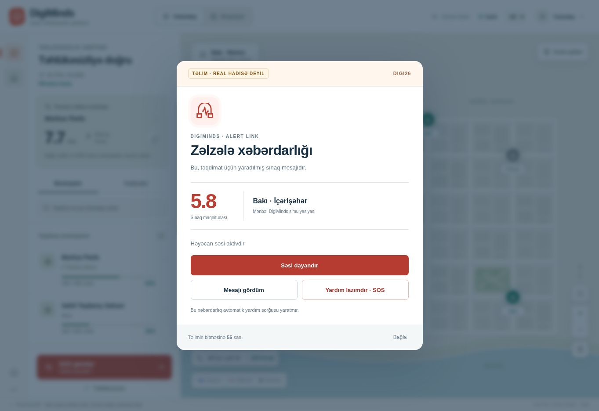
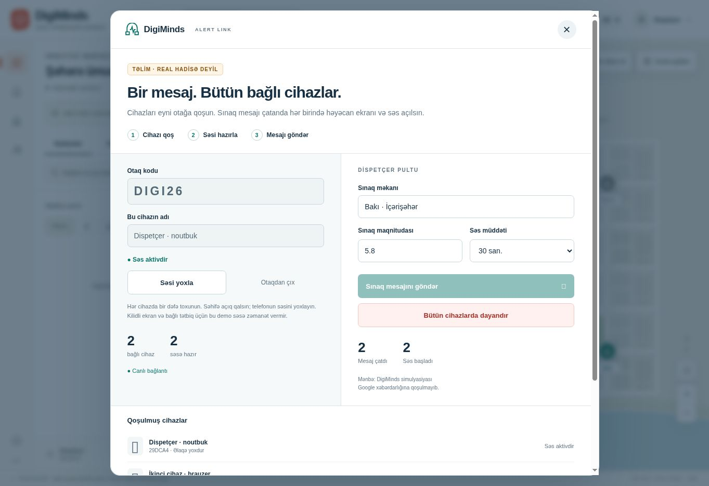

# Zəlzələ mesajı → bağlı cihazlarda həyəcan səsi

Bu funksiya təqdimat üçündür. Mesajı DigiMinds yaradır; Google bildirişini tutmur,
real zəlzələ aşkarlamır və erkən xəbərdarlıq xidməti deyil.

## Təqdimatda istifadə

1. Bu branch-i açın: `feature/earthquake-demo-alerts`.
2. Serveri başladın. Hər cihazda eyni serverin ünvanını açın.
3. Üst menyudan **Zəlzələ təlimi** düyməsini seçin.
4. Hər cihazda eyni otaq kodunu yazın, məsələn **DIGI26**. Cihazlara ayrı ad verin.
5. Hər cihazda **Qoşul və səsi aktivləşdir** düyməsinə toxunun. Qısa yoxlama səsi
   gəlməlidir. Səhifələr açıq qalsın, telefonların media səsini yoxlayın.
6. Göndərən cihazda əvvəlcə **Rol dəyiş → Dispetçer** demo hesabını seçin,
   sonra otağa qoşulun. Digər cihazlar vətəndaş rejimində qala bilər.
7. Məkan, sınaq maqnitudası və 15/30/60 saniyə seçib **Sınaq mesajını göndər** basın.
8. Mesaj otaqdakı açıq səhifələrə çatır. Səs aktivləşdirilibsə alarm başlayır;
   əks halda görünən xəbərdarlıq səsi açmaq üçün toxunma tələb edir.
9. Hər cihaz öz səsini susdura bilər. Dispetçer alarmdakı **Bağla** ilə pulta
   qayıdıb çatma/səs saylarını görür və **Bütün cihazlarda dayandır** edə bilir.

Alarm avtomatik SOS hesabatı və ya briqada tapşırığı yaratmır. Vətəndaşın
**Yardım lazımdır · SOS** düyməsi mövcud yardım formunu açır; göndərmə ayrıca seçimdir.
**Mesajı gördüm** yalnız təlim mesajının qəbul təsdiqidir, “təhlükəsizəm” statusu deyil.




## Eyni Wi-Fi ilə bir neçə telefonda

Asılılıqlar quraşdırıldıqdan sonra şəxsi demo şəbəkəsində:

```bash
python tools/dev.py --host 0.0.0.0 --port 3000
```

Telefonlarda noutbukun **yerli IP ünvanı** ilə açın: `http://YERLI-IP:3000`.
`127.0.0.1` başqa cihazı göstərmir. Bütün cihazlar eyni Wi-Fi/LAN-da olmalıdır;
şəbəkə cihazlararası bağlantıya və serverin portuna icazə verməlidir. Ümumi internet
bağlantısı tələb olunmur, amma serverə yerli bağlantı mütləqdir. Bir server prosesi
işlədin; `BASLAT.cmd` ilə ayrıca açılmış serveri əvvəl bağlayın.

Rol dəyişikliyindən və səhifə yenilənməsindən sonra yenidən qoşulun. Eyni brauzer
profilinin tabları sessiya cookie-sini paylaşır; müxtəlif rollar üçün ayrı telefon,
brauzer profili və ya ayrıca brauzer istifadə edin. Sayğac tab/qoşulma sayıdır,
unikal fiziki insanların və ya telefonların təsdiqlənmiş sayı deyil.

## Texniki sərhədlər

- Yalnız `DEMO_MODE=1`; digər rejimdə bütün drill API-ləri 404 qaytarır.
- Mesaj göndərmə/dayandırma üçün mövcud `demo:write` icazəsi tələb olunur.
- Autentifikasiyalı `/ws/drills` mesajı otağa görə çatdırır. Kanal kəsilərsə açıq
  səhifə saniyəlik HTTP yoxlamasına keçir. Bu, SMS, push və ya mesh şəbəkəsi deyil.
- Cihaz üzvlüyü sessiyaya bağlıdır. Başqa sessiya cihazı ələ keçirə və onun
  mesajını ala bilməz. Otaq kodu demo qruplaşdırmasıdır, təhlükəsizlik sirri deyil.
- Təkrar göndərmə açarı 10 dəqiqə qorunur; eyni açar yeni alarm yaratmır.
  Brauzer son 50 mesaj ID-sini tab sessiyasında saxlayır, yenidən çatmada səs çalmır.
- Müddəti bitmiş və ləğv edilmiş mesajlar qoşulan cihazda səslənmir. Audio qrafı
  maksimum 60 saniyə planlaşdırılır və lokal taymer əlaqə kəsiləndə də dayandırır.
  Ümumi dayandırma offline cihazlara yalnız yenidən qoşulanda çata bilər.
- 15 saniyə xəbər alınmayan cihaz offline göstərilir; üzvlük 120 saniyədə silinir.
  Server maksimum 500 üzvlük və 200 təlim saxlayır. Server yenidən başladıqda hamısı
  sıfırlanır. Çox worker/replica üçün Redis kimi ortaq broker ayrıca tələb olunur.
- “Səs başladı” cihazın göndərdiyi AudioContext təsdiqidir, insanın həqiqətən
  eşitməsinin sübutu deyil. Səssiz rejim, fiziki səs səviyyəsi və brauzerin fon
  məhdudiyyətlərini keçmir. Bağlı tətbiq/kilidli ekran dəstəyi vəd edilmir.
- Real həssas profil məlumatı bu kanala göndərilmir; yalnız cihaz etiketi və
  təlim parametrləri istifadə olunur. Flaş/strob animasiya yoxdur.

## Google bağlantısı üzrə araşdırma — 15 noyabr 2026

Google-un Android zəlzələ xəbərdarlığını üçüncü tərəf veb tətbiqinə ötürən açıq,
rəsmi API tapılmadı. Buna görə təqdimatda “Google-dan canlı gəldi” iddiası yoxdur.
Rəsmi Android səhifəsi istifadəçiyə gələn sistem xəbərdarlığını təsvir edir:

- [Google Android təhlükəsizlik və zəlzələ xəbərdarlıqları](https://support.google.com/android/answer/9319337?hl=en)
- [Android Earthquake Alerts](https://crisisresponse.google/android-early-earthquake-warnings)
- [Chrome autoplay qaydaları — istifadəçi toxunuşu və AudioContext](https://developer.chrome.com/blog/autoplay)

Gələcək Android tətbiqi üçün istifadəçi icazəli
[NotificationListenerService](https://developer.android.com/reference/android/service/notification/NotificationListenerService)
araşdırıla bilər. Bu sinfin mövcudluğu Google-un sistem zəlzələ xəbərdarlığının
mütləq oxunacağı demək deyil: real cihazlarda ayrıca yoxlanmalıdır. Burada belə
bridge yazılmayıb. Rəsmi EEW provayderi ilə inteqrasiya üçün mənbə təsdiqi, coğrafi
hədəfləmə, gecikmə ölçməsi, çatdırılma etibarlılığı və native fon davranışı lazımdır.

[USGS bildirişləri](https://www.usgs.gov/faqs/can-i-get-a-list-receive-email-message-when-there-earthquake-how-do-i-sign-earthquake)
alternativ məlumat mənbəyidir, lakin erkən xəbərdarlıq deyil və adətən silkələnmədən
sonra gəlir. Buna görə USGS demo alarmını avtomatik işə salmır.

## Yoxlama

- Python: icazə, cihaz sahibliyi, otaq izolyasiyası, iki alıcıya çatdırılma,
  WebSocket, təkrar açar, ləğv, vaxtın bitməsi, online/offline, payload sərhədləri,
  CSRF və production rejimində söndürülmə.
- JavaScript: server vaxtına görə ömür, köhnə/ləğv edilmiş mesajın rəddi,
  deduplikasiya, tarixçə limiti, otaq normallaşdırılması və üç dilin tamlığı.
- Chrome-da iki açıq səhifə ilə: eyni mesaj hər iki xəbərdarlıq ekranını açdı;
  pultda **2 mesaj çatdı / 2 səs başladı** göründü. Lokal susdurma və ümumi
  dayandırma yoxlanıldı. Android/iOS fiziki cihaz sınağı aparılmayıb.
