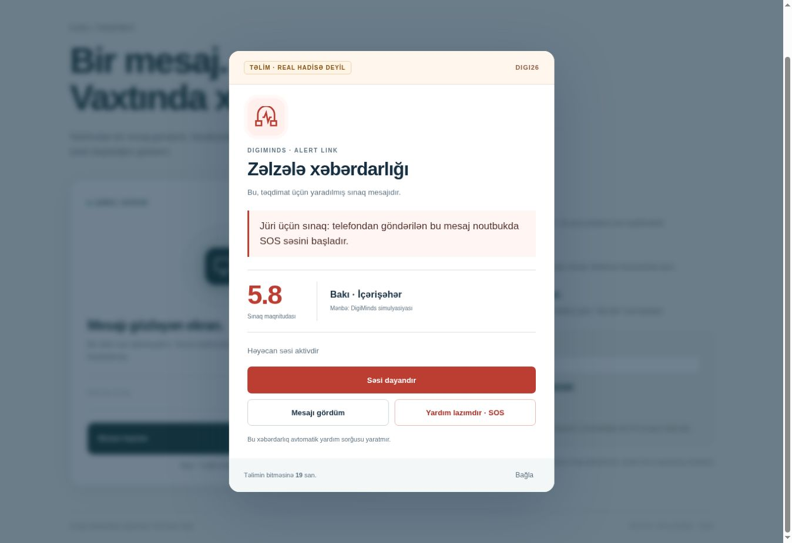
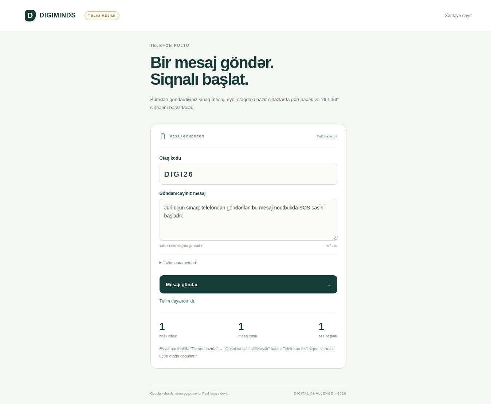

# Jüri qarşısında: telefondan mesaj → noutbukda “dut-dut”

## Hazırlıq — Windows

1. GitHub-dan **main** versiyasını endirin və ZIP-i tam çıxarın. Köhnə server
   pəncərəsini bağlayın. Ayrı versiyaların fayllarını bir qovluqda qarışdırmayın.
2. **JURI_DEMO.cmd** faylını iki dəfə klikləyin. Bu launcher lazımi paketləri
   hazırlayır, serveri yerli şəbəkəyə açır və təqdimat səhifəsini başladır.
3. Noutbukla telefonu eyni Wi-Fi-a qoşun. Alternativ: telefonda hotspot açın,
   noutbuku həmin hotspot-a qoşun. Mobil internet paketi mütləq deyil; cihazların
   bir-birinə çatması vacibdir.
4. Windows firewall soruşarsa, Python üçün özəl şəbəkədə bağlantıya icazə verin.
   Firewall-u tam söndürməyin. Məktəb/zal Wi-Fi-ında cihazlararası əlaqə bağlıdırsa,
   şəxsi hotspot istifadə edin.
5. Noutbukda açılan səhifədə **Ekranı hazırla → Qoşul və səsi aktivləşdir** basın.
   İki qısa “dut-dut” yoxlama səsi gəlməlidir. Səs səviyyəsini uyğunlaşdırın.
6. **Bağla** basın; noutbuk hazır vəziyyətdə mesajı gözləsin. Səhifəni bağlamayın.
7. Təqdimat səhifəsindəki **Telefon pultu** ünvanını telefonda açın. Terminalda da
   `TELEFON PULTU: http://.../remote.html?room=DIGI26` kimi göstərilir.
8. Telefonda **Demo pultunu aç** basın. Otaq kodu hər iki tərəfdə **DIGI26** olsun.

`127.0.0.1` telefondan noutbuku göstərmir. Noutbukun Wi-Fi IPv4 ünvanı lazımdır.
Avtomatik seçilən ünvan VPN/başqa adapterə aiddirsə, Windows-da `ipconfig` açıb
Wi-Fi adapterinin IPv4 ünvanını səhifədəki server ünvanına yazın. Terminaldakı
portu saxlayın; 3000 doludursa launcher başqa port seçə bilər.

Linux/macOS: `python tools/start.py --lan --jury`. Mövcud mühitlə:
`python tools/dev.py --host 0.0.0.0 --port 3000`, sonra noutbukda
`http://127.0.0.1:3000/presentation.html` açın.

## 40 saniyəlik nümayiş

**0–10 saniyə — noutbuk ekranını göstərin:**

> “Bu cihaz xəbərdarlıq qəbul etməyə hazırdır. Eyni otağa başqa telefonlar da
> qoşula bilər. Hazırda real zəlzələ gözləmirik; mesaj mənbəyini simulyasiya edirik.”

**10–20 saniyə — telefonda mesaj yazın və göndərin:**

> “İndi telefonumdan sınaq mesajı göndərirəm.”

Məsələn: **“Zəlzələ xəbərdarlığı: Bakı. Bu, jüri üçün sınaq mesajıdır.”**

**20–30 saniyə — noutbukda nəticəni göstərin:**

> “Mesaj qəbul ekranına çatdı, xəbərdarlıq açıldı və səs avtomatik başladı.
> Pultda çatdırılma və səsin başlaması ayrıca görünür.”

**30–40 saniyə — telefondan dayandırın:**

> “İndi bütün bağlı cihazlarda təlimi dayandırıram. İstifadəçi öz cihazında da
> səsi susdura bilər. Bu xəbərdarlıq avtomatik yardım sorğusu yaratmır.”

Pultdakı **Bütün cihazlarda dayandır** düyməsini basın. Təlim səsi seçilən
15/30/60 saniyədən sonra özü də dayanır.

## Jürinin verə biləcəyi suallar

| Sual | Dəqiq cavab |
| --- | --- |
| Bu mesaj Google-dan gəldi? | Xeyr. Bu təqdimatda öz sınaq mesajımızdır. Google Android xəbərdarlığına birbaşa inteqrasiya yoxdur. |
| SMS və ya WhatsApp mesajı ilə işləyir? | Bu versiyada mesaj DigiMinds telefon pultundan göndərilir. SMS/WhatsApp inteqrasiyası yoxdur. |
| İnternet lazımdır? | Telefonla server eyni yerli şəbəkədədirsə xarici internet lazım deyil. Serverə bağlantı lazımdır. |
| Hər telefon səs verəcək? | Eyni otağa qoşulmuş, səhifəsi açıq və səsi əvvəlcədən aktivləşdirilmiş cihazlar. Kilidli ekran/bağlı brauzer üçün zəmanət yoxdur. |
| “Səs başladı” nəyi sübut edir? | Brauzerin səs mühərriki başladı. Fiziki dinamikin səsi və insanın eşitməsi ayrıca yoxlanmalıdır. |
| Bu real fövqəladə hal sistemi kimi hazırdır? | Təqdimat prototipidir. Real mənbə, native fon rejimi və əməliyyat etibarlılığı ayrıca inteqrasiya və sınaq tələb edir. |

## Təqdimatdan əvvəl bir dəfə yoxlayın

- Telefonda pult açılır, otaq kodları eynidir, ən azı 1 bağlı cihaz görünür.
- Noutbukda iki yoxlama səsi eşidilir; səssiz rejim/çıxış cihazı düzgün seçilib.
- Test mesajı yazıldıqdan sonra noutbukda həmin mətn görünür.
- Səs susdurulur, təkrar mesajda yenidən başlayır, ümumi dayandırma işləyir.
- Proyektor HDMI ilə qoşulubsa, səsin hansı cihazdan çıxdığını yoxlayın.
- Brauzeri yenilədikdən sonra qəbul cihazını yenidən qoşun.

Eyni noutbukda da pultu ayrıca tabda açmaq olar. Pultun demo girişi tokeni yalnız
həmin tabın yaddaşında saxlayır və qəbul ekranının vətəndaş sessiyasını dəyişmir.

## Görünüş düzəlişi

Zəlzələ və profil modulları CSS fayllarını özləri yükləyir. Köhnə giriş HTML-i
keşdə olsa da üslub ayrıca qoşulur. HTML/JS/CSS HTTP keşdən istifadə edərkən
yenidən yoxlanır; Service Worker siyahısına bütün yeni modullar daxil edilib.
Əvvəlki versiya açıqdırsa yeni serverdən sonra **Ctrl+F5** edin.

## Ekran nümunələri

