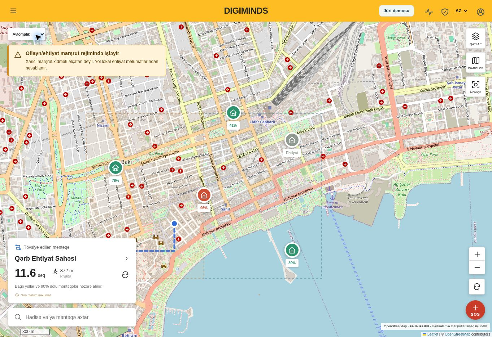

# Xarici xəritə və marşrut API-si sıradan çıxanda

15 noyabr 2026 · DIGITAL CHALLANGE subtaskı

**Nəticə:** HTTP 503 və ya uzun cavab tətbiqi çökdürmür. Birinci nasazlıqdan lokal marşrut qaytarılır. Təkrar nasazlıqlar xarici servisi müvəqqəti dövrədən çıxarır; bərpa bir yoxlama sorğusu ilə təsdiqlənir. Vətəndaş ekranında **“Oflayn/ehtiyat marşrut rejimində işləyir”** görünür.

## Xarici yanaşmalardan nə götürdük?

| Mənbə | Təsvir etdiyi yanaşma | DigiMinds üçün qərar |
| --- | --- | --- |
| [Microsoft Azure — Circuit Breaker](https://learn.microsoft.com/en-us/azure/architecture/patterns/circuit-breaker) | Closed / open / half-open vəziyyətləri; davamlı nasazlıqda uzaq çağırışları dayandırmaq və bərpanı yoxlamaq | 3 ardıcıl xəta → 30 saniyə open → yalnız 1 half-open sorğusu. Xidmətin cavabını gözləmədən lokal nəticə. |
| [Resilience4j — CircuitBreaker](https://resilience4j.readme.io/docs/circuitbreaker) | Vəziyyət maşını, məhdud sayda bərpa sorğusu. Circuit breaker özü paralel sorğuların sayını məhdudlaşdırmır; bulkhead ayrıca lazımdır | Bir prosesdə ən çox 4 xarici çağırış. Artıq sorğular növbədə gözləmədən lokal hesablanır. Gecikmiş köhnə uğurlu cavab yeni açılmış circuit-i bağlaya bilmir. |
| [AWS Builders’ Library — Timeouts, retries, backoff with jitter](https://aws.amazon.com/builders-library/timeouts-retries-and-backoff-with-jitter/) | Təkrar cəhdlər yüklənmiş servisi daha da yükləyə bilər. Vaxt büdcəsi və cəhdlərin zamana yayılması vacibdir | Eyni vətəndaş sorğusu daxilində retry yoxdur. Brauzerdə sonrakı yoxlama fasilə + təsadüfi 0–1 saniyə ilə edilir. AWS-in bütün xidmətlərinin bizim circuit sxemimizdən istifadə etdiyini iddia etmirik. |
| [HTTPX — Timeouts](https://www.python-httpx.org/advanced/timeouts/) | Read timeout bütün sorğunun deyil, məlumat hissələri arasındakı gözləmənin limitidir | HTTPX timeout-u ilə yanaşı `asyncio.timeout(4.5)` ümumi asinxron sorğu limiti. Brauzerdə ayrıca 5 saniyəlik limit. |

Bu mənbələr memarlıq qərarları üçündür. Java kitabxanasını Python layihəsinə əlavə etmədik; kiçik, test edilən Python vəziyyət maşını yazdıq. Saylar — 3 xəta, 30 saniyə, 4 paralel sorğu — prototip üçün bizim seçimimizdir, mənbələrin məcburi standartı deyil.

## Niyə sadəcə try/except kifayət etmir?

Try/except tək sorğunu qoruyur. Minlərlə vətəndaş eyni nasaz servisi çağıranda hər sorğu yenə timeout gözləyər. Buna görə üç ayrı qoruma var: vaxt limiti, circuit breaker və paralellik limiti. Əvvəlcədən lokal marşrut hesablanır; xarici çağırış alınmasa, nəticə hazırdır.

Bir köhnə marşrut xəttini kor-koranə göstərmək də uyğun deyil: onun yolu sonradan bağlana və ya son məntəqə 90% dola bilər. Biz ehtiyat kimi SQLite-dəki koordinat/yol qrafında Dijkstra işlədirik. Brauzer serverə də çata bilməyəndə son saxlanmış qrafı və yol/məntəqə vəziyyətini istifadə edir. Xarici marşrutların ayrıca son-nəticə keşi bu subtask üçün lazım deyil; statik koordinat bazası tələbin icazə verdiyi alternativdir.

## Sorğunun gedişi

1. İcazə, koordinatlar və mövcud rate limit yoxlanılır.
2. Lokal qrafdan uyğun marşrutlar hazırlanır. Bağlı yollar, bağlı məntəqələr və doluluğu **90% və yuxarı** olan məntəqələr çıxarılır.
3. Avtomatik rejimdə xarici provayder qurulubsa və circuit icazə verirsə, sorğu göndərilir. API açarı olmayanda lokal rejim normal işləyir; bu hal saxta nasazlıq kimi göstərilmir.
4. HTTP 503, digər uğursuz HTTP statusları, şəbəkə/timeout xətası və yararsız cavab lokal nəticə ilə əvəz edilir. Xarici cavabın koordinatları, son nöqtələri və bağlı yoldan keçməməsi yoxlanır.
5. Xarici sorğu gözlənilərkən vəziyyət dəyişibsə, lokal marşrut yenidən hesablanır. Gecikmiş cavab yeni bağlanmış yolu bərpa edə bilmir.
6. Cavab `routing.mode`, səbəb, circuit vəziyyəti, vaxt, xarici çağırış olub-olmaması və `no_route` daşıyır. Lokal marşrut varsa HTTP 200 qaytarılır. Uyğun marşrut yoxdursa boş siyahı və `no_route: true` verilir; düz xətt “təhlükəsiz marşrut” kimi uydurulmur.

### Circuit vəziyyətləri

- **Closed:** provayderə icazə var; hər uğursuz çağırış özü dərhal lokal cavaba keçir. 3 ardıcıl xəta circuit-i açır.
- **Open:** 30 saniyə yeni xarici çağırış yoxdur. Lokal hesablamalar davam edir. Açılmadan əvvəl başlamış çağırışlar bitə bilər; ümumi say 4 ilə məhduddur.
- **Half-open:** fasilədən sonrakı ilk sorğu tək yoxlama kimi keçir. Digərləri lokaldan cavab alır. Uğur circuit-i bağlayır; xəta yeni 30 saniyəlik fasilə yaradır.

Frontend marşrut API-sinin özünü də 5 saniyə ilə məhdudlaşdırır. API əlçatmazdırsa lokal brauzer qrafı işləyir. `401`, `403`, `422`, `429` autentifikasiya, icazə, validasiya və rate limit xətalarıdır; onlar səssizcə şəbəkə nasazlığına çevrilmir.

## Xəritə ilə marşrut ayrı qorunur

Xəritə təsviri OpenStreetMap görünən tile-ları, marşrut isə server/local qraf istifadə edir. Marşrut provayderi sıradan çıxsa, işləyən xəritəni söndürmürük. Tile yüklənməsində xəta və ya 5 saniyəlik gecikmə ayrıca ehtiyat xəritəni açır.

Ehtiyat xəritə tətbiqlə verilən `baku.geojson` real küçə çıxarışıdır. Lokal fayl erkən yüklənir və Service Worker tərəfindən saxlanır; OSM tile-ları toplu endirilmir. 30 saniyədən sonra görünən sahədən yalnız bir tile yoxlanır. Onlayn xəritə bərpa ediləndə avtomatik geri qayıdır. Lokal fayl da yüklənməzsə bu açıq yazılır, mövcud marşrut siyahısı işləməyə davam edir.

Tam internet kəsilməsində əvvəl yüklənmiş tətbiq/keş lazımdır. Hələ heç açılmamış saytı şəbəkəsiz ilk dəfə yükləmək və ya olmayan lokal məlumatı bərpa etmək bu mexanizmin imkanına daxil deyil.

## Jüriyə nümayiş

API açarı tələb olunmur. Sınaq provayderi real HTTPX transport yolundan 503 qaytarır və ya asinxron olaraq 6 saniyə gözləyir; sadəcə ekranda status dəyişmir.

1. **Dispetçer → demo Dispetçer → Challenge laboratoriyası** açın.
2. **HTTP 503 yarat** basın. Nəticədə `provider_http_503`, lokal marşrut və ölçülmüş vaxt görünür.
3. **Marşrutu yoxla** ilə ümumilikdə 3 xəta yaradın. Sonrakı sorğuda `circuit_open` görünəcək və provayderə çağırış edilməyəcək.
4. **Vətəndaş** görünüşünə keçin. Xəritə, yerli marşrut və sarı **“Oflayn/ehtiyat marşrut rejimində işləyir”** bildirişi birlikdə görünür.
5. **Servisi bərpa et** seçin. Circuit açıqdırsa 30 saniyəlik fasilə qorunur. Növbəti avtomatik və ya **Marşrutu yoxla** sorğusu tək probe ilə online rejimə qaytarır.
6. Circuit bağlandıqdan sonra **6 saniyə gecikdir** basın. Təxminən 4,5 saniyədə `provider_timeout` və lokal marşrut alınır.
7. **Sınağı bitir** qurulmuş real provayderə, açar yoxdursa normal lokal rejimə qaytarır.

Təqdimat cümləsi: “Xarici servis 503 qaytarır. Sistem lokal məlumatdan marşrutu saxlayır və bunu vətəndaşa bildirir. Təkrar xətalarda circuit açılır, nasaz API-yə yük dayandırılır. Servis düzələndə yalnız bir yoxlama sorğusu ilə normal rejim bərpa olunur.”

## Təhlükəsizlik və sərhədlər

- Nasazlıq simulyasiyası yalnız demo rejimində, `demo:write` icazəli rol üçün açıqdır; vətəndaşa 403 qaytarılır. Ssenari dəyişikliyi auditə yazılır.
- API açarı yalnız serverdə qalır. Lokal fallback mövcud RBAC və sorğu limitlərini aradan qaldırmır.
- Circuit yaddaşı və 4 çağırış limiti **hər proses üçündür**. Çox worker/replika üçün ümumi limit, paylaşılmış vəziyyət və ya gateway siyasəti əlavə edilməlidir; hazırkı prototip tək proses üçündür.
- Fallback canlı məlumat əldə etməyə zəmanət deyil. Tam şəbəkə kəsiləndə yol və doluluq məlumatı son saxlanmış vəziyyətdir; UI bunu göstərir.
- Fon xəritəsi real OSM çıxarışıdır. Mövcud təxliyə qrafı, hadisələr və məntəqələr təlim məlumatıdır; rəsmi təsdiqli təxliyə şəbəkəsi deyil.

## Yoxlama nəticələri

15 noyabr 2026: **75 Python testi və 20 JavaScript testi keçdi.** Xarici real ORS xidmətində nasazlıq yaratmadıq; idarə olunan transport və lokal demo ssenariləri istifadə edildi.

- Faktiki 6 saniyə gözləyən provayder coroutine-i ləğv edildi; HTTP cavabı 4,3–5,0 saniyə aralığında, lokal marşrutla gəldi.
- 3 dəfə 503 → open; dördüncü çağırış provayderə getmədi.
- 20 eyni vaxtlı API sorğusu → 4 xarici çağırış, 16 dərhal `provider_busy` fallback; hamısı HTTP 200 və lokal marşrut aldı.
- Half-open tək probe, uğursuz probe-dan yenidən open, uğurlu probe-dan closed; əvvəlki nəsildən gecikmiş uğur nəzərə alınmadı.
- Sorğu gözlənilərkən yolun bağlanması və məntəqənin dolması yeni lokal hesablamada nəzərə alındı.
- Şəbəkə xətası, read timeout, pozulmuş JSON, NaN və səhv cavab forması idarə edildi.
- Bütün yollar bağlı olduqda boş nəticə; brauzer fallback-da lokal məlumat olmadıqda və əhatə xaricində idarə olunan vəziyyət.
- Tile gecikməsi/xətası, bərpa probe-u və AZ/EN/RU dillərində panel bağlı olsa da görünən bildiriş yoxlandı.

Əsas fayllar: `backend/circuit.py`, `backend/app.py`, `frontend/routing-client.js`, `frontend/map-circuit.js`, `frontend/map-base.js`, `frontend/resilience-i18n.js`.

```sh
python -m pytest -q
node --test tests/*.test.mjs
```


