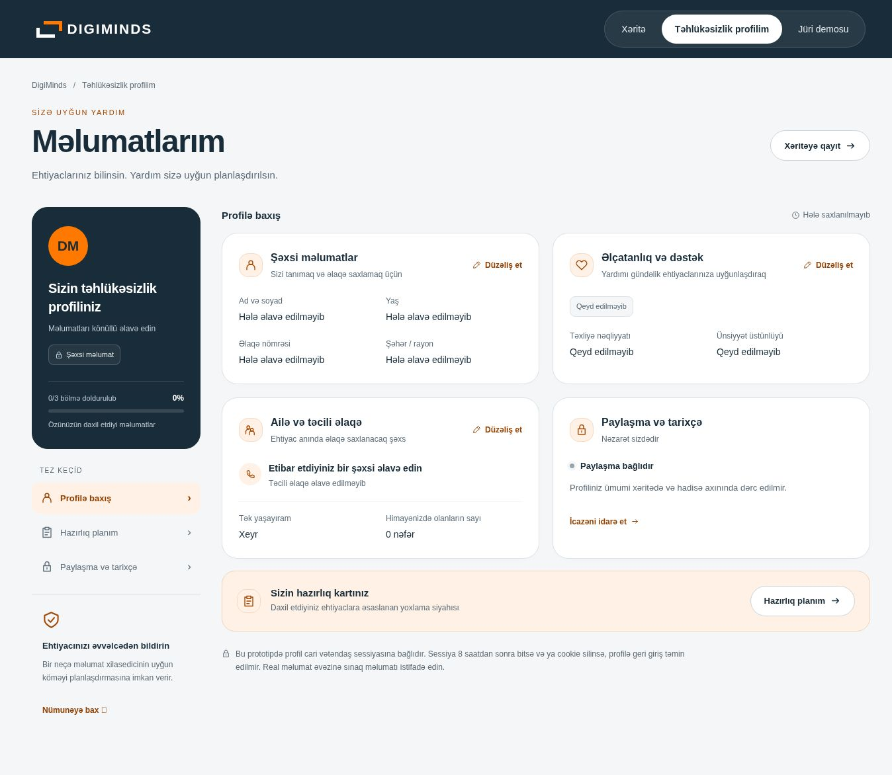
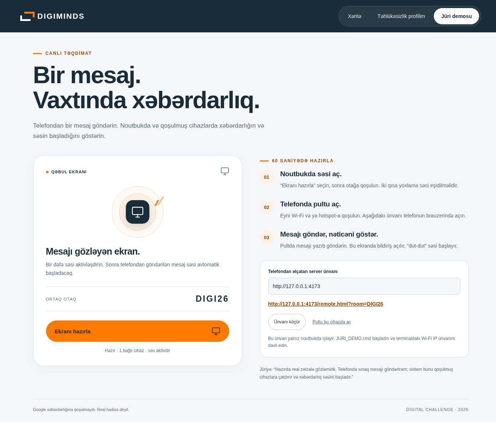

# Map workspace redesign — 15 November 2026

The citizen and dispatcher screens now share a map workspace instead of a vertically stacked dashboard. All code and icons are original to this project; no Perimeter or Watch Duty brand assets are included.

## Reference patterns

- [Perimeter Map](https://perimeterplatform.com/perimeter-map): a common map for closures, resources and zones, a compact information sidebar, and map-layer controls. Its public map shell was inspected; the basemap did not render in this browser.
- [Watch Duty](https://www.watchduty.org/): clear hazard symbols, a consolidated alert feed and concise shelter/evacuation information. The official site's illustrated interface was inspected. The live web app reported that this browser was unsupported, so its live interactions were not evaluated.

## Implemented behavior

- Citizen: recommended walking route, occupancy bars, shelter search and details, a prominent SOS entry point with four one-click emergency choices, safe status and a visible unsent queue.
- Dispatcher: active critical alert first, incident/type filters, shelter/team tabs, compact map metrics and contextual response actions. Expired alert triggers use a neutral archived style.
- Road editing is an explicit mode. Selecting a road opens details; a separate button applies closure/reopening. This avoids mutating routes during ordinary map navigation.
- Layers can independently hide shelters, incidents, teams and zone overlays. Drag, wheel zoom, zoom/reset controls and keyboard map navigation use bundled SVG geometry.
- Map markers show active incidents by default; selecting a historical incident displays that incident without crowding the default map.
- Role and scenario tools are separate dialogs; mobile users can reach them through the account menu. Backend permission checks remain authoritative.
- UI text is available in Azerbaijani, English and Russian. Place names remain the dataset's proper names. Icon-only controls retain accessible names. Dialog focus is contained and Escape closes overlays. Form drafts and scrolling survive snapshot renders; drafts are scoped to the selected shelter.
- The Service Worker precaches the new UI, map and translation modules. There are no remote font, map-tile or frontend-script dependencies.

## Validation

- 33 Python tests and 8 Node tests pass. New UI regression tests cover public/operational separation, active versus archived alerts, explicit road mutation, escaped search input, translation parity and offline module coverage.
- Browser: citizen fire SOS accepted; repeat support kept report count at one; safe status updated; shelter search narrowed to the northern stadium; live occupancy changed from 384 to 385 and was restored to 384; layers toggled without discarding the in-progress occupancy input; road selection left the road open, closure changed its status to closed, and reopening restored it.
- Stopped the managed backend and reloaded the citizen app: the cached redesigned interface and SVG map opened, the offline banner was visible, and browser routing returned the 872 m / 11.6 min path. Restarted the backend after the check.
- Responsive CSS inspected using browser zoom at 545 and 337 CSS-pixel widths, with no horizontal document overflow. This is a narrow-viewport browser check, not a physical-device audit. A tablet grid-column bug and missing labels on mobile icon controls were corrected during this pass.

The basemap and operational data are still synthetic training data, visibly labelled in the interface. This redesign does not make the prototype official evacuation guidance.

## Reference-faithful revision

At the user's request the previous custom green dashboard was replaced with two separate reference layouts:

- **Citizen / Watch Duty:** yellow masthead, centered black wordmark, full-screen map, stacked Layers/Legend controls, bottom search and an incident drawer. DigiMinds route and SOS actions use this shell.
- **Dispatcher / Perimeter:** white logo/search header, slim white map toolbar, floating information panel, upper-right zoom and lower-right round layer/add controls.

Original product logos and source code are not included. The visible structures were reimplemented around DigiMinds APIs. The synthetic offline map and backend behavior remain. This revision received JavaScript syntax checks, the existing lightweight UI/routing checks, and a short browser check of both layouts, SOS dialog and search. The backend/load/Windows suites were not rerun locally for this styling revision.

## Scrollable homepage and geographic basemap revision

The root route is now a separately authored presentation page following the supplied Perimeter website screenshots: a dark sticky header with large rounded navigation, orange hero, desktop/phone map composition, broad white map/text sections, about content, FAQ and closing CTA. Navigation opens real workspace entry points (`#sos`, `#shelters`, `#route`, `#dispatcher`, `#offline`) or scrolls to the chosen content section. Mobile navigation collapses into a menu.

The workspace moved to `/workspace.html`. Its synthetic SVG basemap was removed and replaced with vendored Leaflet plus OpenStreetMap raster imagery and a bundled real OSM vector extract. The map DOM and viewport survive live state renders. Existing business workflows and training graph are preserved; see `map-data.md` for the distinction between real geography and simulated routing.

Verification: JS syntax, existing UI tests, and focused desktop browser checks of the homepage, section navigation, real map display and offline-layer toggle. No extended load or Windows run was performed for this visual revision.

## Shared visual language for profiles and jury alerts

The safety profile, jury receiver, phone console and alert dialogs now follow the homepage's navy (`#182c39`), orange (`#ff7900`), white surfaces, Arial typography and rounded controls. A shared `product-theme.css` defines the palette and navigation, and `product-ui.js` renders the same DigiMinds mark and Map / Safety profile / Jury demo links. The existing citizen and dispatcher map layouts remain intact.

Profile editing, consent, delivery receipts, audio activation and remote stop retain their previous behavior. Text and control sizes were increased in the phone console; the profile's back button wraps below the title on narrow screens. Revisioned feature styles load their shared theme explicitly, and the offline shell can match versioned static asset requests against its cached files.

Validation: all 12 JavaScript checks pass, including offline module coverage; JS syntax and whitespace checks pass. Browser checks covered the profile editor, the redesigned alarm panel, message delivery/audio-start and remote stop. At 337 CSS pixels of usable width, both the profile and authenticated phone console have no horizontal document overflow. This is browser zoom testing, not physical phone testing. Backend code was not changed in this visual update.

