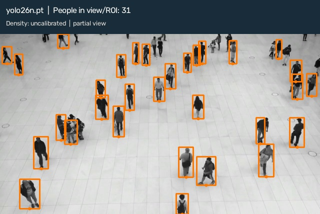

# YOLO26 — insan sayı və sıxlıq sınağı

Yoxlama: **15 noyabr 2026**. Standart model **YOLO26n**, `imgsz=960`, `confidence=0.25`, `max_det=1000`, CPU-da 4 PyTorch thread. Ultralytics **8.4.213** və PyTorch **2.15.0+cpu** ilə faktiki inference işlədildi. Mövcud paket artıq ən son PyPI buraxılışı idi; lazımsız yenilənmə edilmədi.

[Ultralytics model kataloqu](https://docs.ultralytics.com/models/) YOLO26-nı son yayımlanmış ailə kimi göstərir; YOLO27 hələ yayımlanmayıb. `n`, `s`, `m` eyni ailənin ölçüləridir. Seçim yalnız versiya adına əsaslanmayıb: bizim CPU sınağında `n` daha sürətli idi. Bu, bütün kameralar üçün ən dəqiq variant olduğu demək deyil.

## Faktiki müqayisə

Mənbə: [rəsmi Ultralytics nümunə videosu](https://github.com/ultralytics/assets/releases/download/v0.0.0/solutions_ci_demo.mp4), 640×360, 30 FPS, 62 kadr. Hər modeldə eyni 31 kadr (0, 2, …, 60), 3 isinmə çağırışından sonra ölçüldü. Aşağıdakı cədvəldə hamısının giriş ölçüsü 960, etibar həddi 0.25, NMS IoU həddi 0.7-dir.

| Model | Kadrda aşkarlanan say | Orta say | Median model çağırışı | Emal sürəti |
| --- | ---: | ---: | ---: | ---: |
| YOLO11n | 32–41 | 35.87 | 167.38 ms | 4.77 kadr/s |
| **YOLO26n** | **27–35** | **31.10** | **84.28 ms** | **10.36 kadr/s** |
| YOLO26s | 19–24 | 21.42 | 231.49 ms | 3.65 kadr/s |
| YOLO26m | 17–22 | 19.77 | 512.85 ms | 1.86 kadr/s |

Bu saylar **dəqiqlik faizi deyil**: video üçün insan tərəfindən işarələnmiş həqiqi saylar yoxdur. YOLO11n bu səhnədə daha çox insan aşkarladı. Yeni modelin daha dəqiq olduğunu iddia etmirik. Yuxarıdan görünən, uzaq və qismən örtülmüş insanlar hələ buraxılır; sadəcə modeli böyütmək problemi həll etmədi. FPS yalnız isinmiş model çağırışlarını əhatə edir; video oxuma, şəkil yazma, şəbəkə və ilk açılış daxil deyil. Başqa kompüterdə nəticə fərqlənəcək.

640 / 0.35 ilkin konfiqurasiyası və bütün kadr sayları [JSON hesabatında](yolo26-benchmark.json) saxlanılıb. Model çəkilərinin və mənbə videonun SHA-256 dəyərləri də oradadır.

## Worker sınağı

- Bütün **62 kadr** ayrıca worker ilə emal edildi: **27–35 aşkarlama**, son kadrda **31**.
- Rəsmi `bus.jpg`: **4 insan**. Qara boş test görüntüsü: **0 insan**.
- Sahə verilmədiyindən bütün real görüntü nəticələrində `density_people_m2=null` qaldı. Uydurma m² istifadə edilmədi.
- Təkrar kadrlar sayları toplamır. Hər kadr həmin anda görünən insanları ölçür.
- Sensor/API integration testi 3 nəfər / **sintetik 12 m²** = 0.25 nəfər/m² və sonra 0 nəfər yenilənməsini yoxlayır. Bu, hesablama və API müqaviləsinin testidir, kameranın fiziki kalibrasiyası deyil.
- ROI sərhədi, sıfır/NaN/sonsuz sahə, etibarsız poliqon, deteksiya limiti, qismən görünüş və bağlantı kəsildikdən sonra növbəti göndəriş sınaqları var.



Şəkil rəsmi nümunə videonun diaqnostik kadrıdır; narıncı qutular və say DigiMinds worker tərəfindən əlavə edilib. Mənbə: Ultralytics assets; [upstream lisenziya](https://github.com/ultralytics/assets/blob/main/LICENSE). Bu, bizim real kamera görüntümüz deyil.

Yekun yoxlama: **86 Python testi və 20 JavaScript testi keçdi**. Python testlərinin 14-ü vision/sensor davranışını yoxlayır.

## Öz video və kameramızla işə salmaq

```bash
python -m pip install -r requirements-vision.txt
python -m vision.worker --source video.mp4 --save-preview data/yolo-preview.jpg
```

Kamera üçün `--source 0`; səlahiyyətli RTSP mənbəsi də işlədilə bilər. Çəkilər ilk açılışda yüklənir. İnternetsiz təqdimat üçün `yolo26n.pt` faylını qabaqcadan yükləyib yerli yolunu `--model` ilə verin. `--save-preview` son kadr şəklini yeniləyir, konsolda hər kadr üçün JSON olur.

Sıxlığı ölçmək üçün:

1. Kameranı sabit mövqeyə qoyun. Görüntüdə hesablanacaq döşəmə sahəsini seçin.
2. Orijinal görüntünün piksel koordinatları ilə ROI poliqonunu JSON faylına yazın: `[[x,y],[x,y],[x,y],...]`.
3. Həmin poliqonun **real yer səthindəki sahəsini m² ilə ölçün**. Piksel sahəsi və ya görüntüdən görünməyən bütün zalın sahəsi uyğun deyil.
4. `--roi roi.json --area-m2 OLCHULMUSH_SAHE` əlavə edin. Məsələn, ölçülmüş sahə həqiqətən 120 m²-dirsə `--area-m2 120`.

Şəxsin qutusunun alt mərkəzi ROI daxilindədirsə sayılır. Sıxlıq həmin sayın sahəyə bölünməsidir və **görünən insanların təxmini sıxlığıdır**. Modelin buraxdığı insanlar bu rəqəmə daxil olmur. Kamera köçürüləndə və ya görüntü ölçüsü dəyişəndə ROI/sahə yenidən yoxlanmalıdır.

## Xəritədəki məntəqə ilə əlaqə

Server və worker eyni `SENSOR_KEY` mühit dəyişənini istifadə etməlidir. Bütün məntəqə sahəsi kamerada görünürsə, worker əmrində `--coverage full --publish --shelter s1 --api http://127.0.0.1:3000` istifadə edin. Məntəqə detalında say, doluluq, mənbə və varsa nəfər/m² yenilənir. Qismən ROI bütün məntəqənin doluluğunu dəyişmir.

`max_det` limitinə çatmış nəticə natamam ola bilər: worker xəbərdarlıq verir və onu doluluq kimi göndərmir. Şəbəkə xətası növbəti kadrın emalını dayandırmır. Fayl videosu replay rejimidir; onun `observed_at` vaxtı emal vaxtıdır, çəkiliş vaxtı deyil.

## Təkrar müqayisə

```bash
python -m vision.benchmark --source video.mp4 \
  --models yolo11n.pt yolo26n.pt yolo26s.pt yolo26m.pt \
  --imgsz 960 --confidence 0.25 --output test-results/yolo26/benchmark.json
```

Növbəti dəqiqlik yoxlaması üçün öz kameramızdan müxtəlif doluluqlarda işarələnmiş kadrlar lazımdır. Həqiqi sayla fərqi (MAE, az/çox sayma), örtülməni və işıq dəyişməsini ölçdükdən sonra hədd/model seçimi və lazım gələrsə fine-tuning edilə bilər. Bu sınaqda canlı CCTV/RTSP, GPU və çoxkameralı təkrar sayma yoxlanmayıb.
